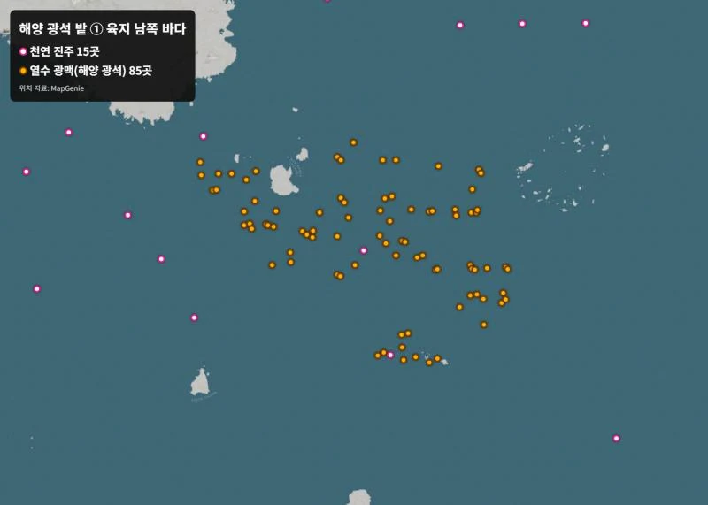
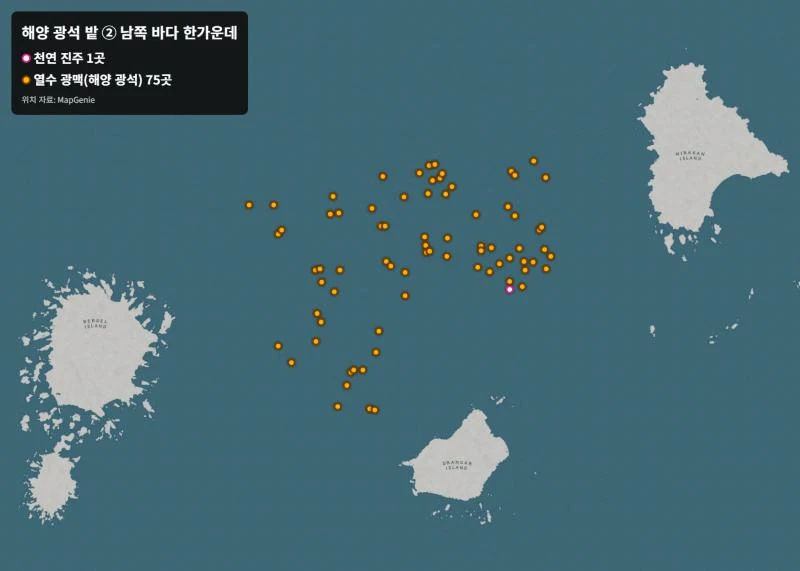

**붉은사막 천연 진주 위치**와 **해양 광석 위치**를 찾다 보면, 지도 사이트에 아이콘이 수백 개씩 한꺼번에 떠서 정작 필요한 재료가 어디 있는지 안 보이죠. 그래서 DLC "미지의 여정"에서 배를 만들 때 쓰는 **바다 재료 두 가지만** 골라 지도에 다시 찍었습니다. 천연 진주는 바다 전체에 흩어진 53곳, 해양 광석(열수 광맥)은 두 지역에 몰린 160곳이에요.

📌 3줄 요약
<b>해양 광석(열수 광맥) 160곳은 딱 두 곳에 몰려 있습니다.</b> 육지 바로 남쪽 바다(85곳)와 남쪽 바다 한가운데 섬 세 개 사이(75곳)예요.

<b>천연 진주 53곳</b>은 바다 전체에 하나씩 흩어져 있어요. 육지 남쪽 해안선과 동쪽 바다에 특히 많습니다.

미완의 배 건조에는 <b>천연 진주 5개</b>가 필요하니, 육지 남쪽 해안을 배로 한 바퀴만 돌아도 충분히 모입니다.

## 붉은사막 진주·해양 광석 전체 지도

아래 지도에서 **분홍 점이 천연 진주**, <b>주황 점이 열수 광맥(해양 광석)</b>입니다. 다른 아이콘은 전부 끄고 이 두 가지만 남겼어요.

한눈에 봐도 차이가 큽니다. 진주는 넓은 바다에 띄엄띄엄 있어서 "지나가는 길에 하나씩 줍는" 재료예요. 반면 광맥은 두 덩어리로 뭉쳐 있어서 **한 번 가면 수십 개를 한꺼번에** 캘 수 있는 재료입니다.

그래서 순서는 이렇게 잡으면 편해요. 먼저 광맥 밭 한 곳에 배를 대고 잠수해서 광석을 몰아서 캐요. 그다음 돌아오는 길에 진주를 줍습니다. 진주를 먼저 줍겠다고 바다를 헤매면 시간이 두 배로 듭니다.

| 재료 | 개수 | 분포 | 추천 방법 |
| --- | --- | --- | --- |
| 천연 진주 | 53곳 | 바다 전체에 흩어짐 | 이동하면서 하나씩 줍기 |
| 열수 광맥(해양 광석) | 160곳 | 두 지역에 몰림 | 한 곳에 배 대고 몰아 캐기 |

## 해양 광석 밭 ① 육지 바로 남쪽 바다 (85곳)

첫 번째 광맥 밭은 **육지 남동쪽 반도 끝에서 바로 남쪽 바다**에 있습니다. 항구에서 가까워서 처음 가기 좋은 곳이에요.

이 지역은 가운데 작은 섬을 중심으로 광맥이 넓게 퍼져 있어요. 범위가 넓은 대신 육지와 가까워서 오가기가 쉽습니다. 근처에 진주도 15곳 정도 섞여 있어서 광석과 진주를 같이 모으기 좋아요.

팁을 하나 드리면, 가운데 작은 섬 옆에 배를 세워 두고 거기서부터 바깥으로 원을 그리듯 돌면 놓치는 광맥이 줄어듭니다. 숨이 모자라면 중간중간 수면으로 올라왔다가 다시 들어가세요.

## 해양 광석 밭 ② 남쪽 바다 한가운데 (75곳)

두 번째 밭은 **남쪽 바다 한가운데, 큰 섬 세 개 사이**에 있습니다. 첫 번째보다 멀지만 광맥이 훨씬 촘촘하게 모여 있어요.

광맥이 좁은 범위에 몰려 있어서 **배를 거의 안 옮기고** 잠수만 반복하면 됩니다. 공작석처럼 수십 개가 필요한 재료를 모을 땐 이쪽이 더 빨라요. 다만 이 근처엔 진주가 1곳뿐이라 진주는 따로 모아야 합니다.

## 천연 진주 빨리 모으는 순서

진주는 53곳이지만 미완의 배 건조에는 **5개만** 있으면 돼요. 그러니 전부 돌 필요가 없습니다.

1. 육지 남쪽 항구에서 출발합니다.
2. **남쪽 해안선을 따라 서쪽으로** 배를 몰면서 지도의 분홍 점을 하나씩 들릅니다.
3. 해안선에만 진주가 10곳 넘게 있어서, 이 길만 돌아도 5개는 금방 채워져요.
4. 더 필요하면 **동쪽 바다** 쪽 진주를 이어서 줍습니다.

진주는 보통 바닷속 바닥에 있으니 배를 멈추고 잠수해서 찾아야 해요. 물이 탁하면 잘 안 보이니 낮에 가는 걸 추천합니다.

## 미완의 배 건조에 필요한 재료 정리

DLC에서 "미완의 배 건조"를 하려면 이 재료들이 필요합니다.

| 재료 | 필요 개수 | 얻는 곳 |
| --- | --- | --- |
| 천연 진주 | 5 | 바다 전체(이 글 지도) |
| 해송 | 15 | 아직 확인 중(해안가 소나무 벌목 추정) |
| 공작석 | 50 | 광석 채광(열수 광맥 밭 우선 확인) |
| 필요 인원 | 10명 | 기술 조건을 갖춘 선원 |
| 작업 시간 | 4일 4시간 | — |

⚠️ 확인해 주세요
"해양 광석"을 열수 광맥으로 보고 표시했습니다. 열수 광맥에서 공작석이 나오는지는 게임에서 직접 캐 보며 확인 중이에요. 재료 이름에 마우스를 올리면 게임 안에서 획득처를 보여 주니 함께 확인하세요.

## 자주 묻는 질문

**Q. 진주가 지도 위치에 없어요.**
이미 캤거나 물이 탁해서 안 보이는 경우가 많아요. 바닥 가까이 내려가서 다시 살펴보고, 그래도 없으면 다른 분홍 점으로 먼저 가 보세요.

**Q. 광맥을 캘 때 도구가 필요한가요?**
육지 광석처럼 곡괭이를 챙겨 가세요. 오래 잠수하려면 유물 상인에게서 호흡 장치를 사 두면 편합니다.

**Q. 어느 광맥 밭이 더 좋아요?**
처음엔 가까운 ①번, 많이 모아야 할 땐 촘촘한 ②번이 좋습니다.

**Q. 선원 10명은 어디서 구하나요?**
벨루아 마을의 선박 관리인에게서 선원을 배에 태울 수 있어요. 미완의 배는 기술 조건이 있으니 벌목·제련 같은 기술을 가진 선원을 골라야 합니다.

위치 자료는 [MapGenie 붉은사막 지도](https://mapgenie.io/crimson-desert/maps/pywel)의 데이터를 바탕으로, 바다 재료 두 가지만 골라 다시 표시했습니다. 다른 게임 정보는 [콘솔 게임 추천 글](/console-game-recommendations/)에서도 볼 수 있어요.

---

**관련 키워드** — #붉은사막 #붉은사막진주 #천연진주위치 #해양광석 #열수광맥 #미지의여정 #붉은사막DLC #미완의배 #공작석 #붉은사막지도
