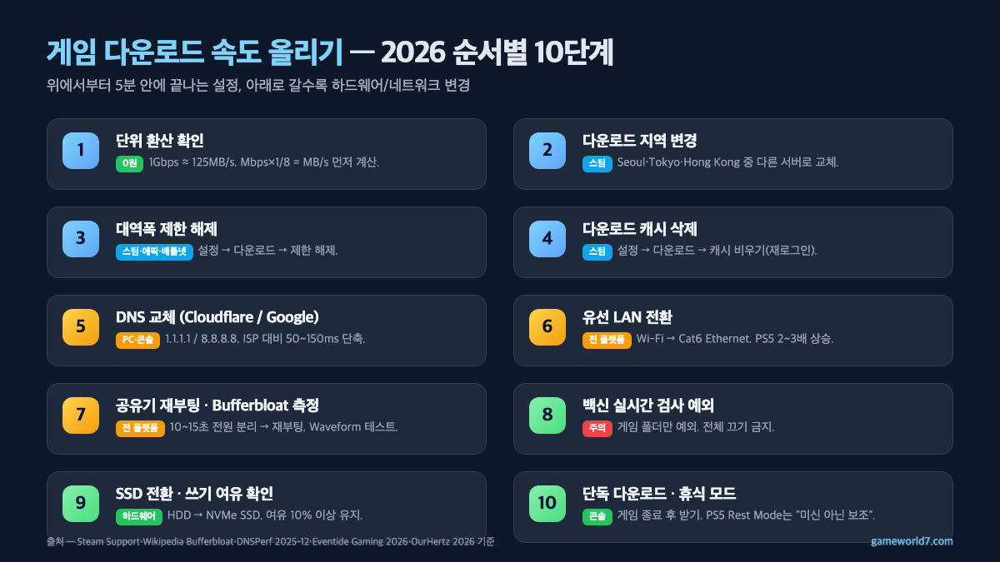

**게임 다운로드 속도 올리기**의 가장 빠른 답은 세 가지에서 끝나요.

① 내 속도가 "정말로 느린지" **단위부터 환산**한다(Mbps는 8로 나눠야 MB/s — 1Gbps ≈ 125MB/s가 이론 상한, Steam 공식 지원 문서 기준).
② 스팀·배틀넷·에픽 같은 클라이언트의 **다운로드 지역을 Seoul·Tokyo·Hong Kong 사이에서 바꿔보고** 대역폭 제한이 꺼져 있는지 확인한다.
③ PC·콘솔 **DNS를 Cloudflare 1.1.1.1 또는 Google 8.8.8.8**로 교체한다(DNSPerf 2025년 12월 집계 기준 Cloudflare 평균 10.36ms · Google 19.16ms).

이 세 가지로 체감 2~3배가 올라오고, 그래도 느리면 유선 LAN·공유기 재부팅·SSD 여유 공간 순으로 내려가면 됩니다. 이 글은 스팀·배틀넷·에픽·PS5·Xbox·닌텐도 스위치에서 공통으로 쓰는 **10단계 순서를 2026년 11월 기준 공식 자료와 벤치마크로** 정리한 가이드예요.

📌 3줄 요약 (2026년 11월 기준)
<b>게임 다운로드 속도 올리기 1순위는 "다운로드 지역 변경 + 대역폭 제한 해제"</b>입니다. Steam Support 공식 가이드(store.steampowered.com Help → Download Issues)가 공통으로 1단계로 지정한 설정이고, OurHertz 2026·GGem Guide 2026·4DDiG 2026 세 가이드 모두 같은 순서를 1~2위로 둡니다.

2순위는 <b>DNS 교체(Cloudflare 1.1.1.1 / Google 8.8.8.8)와 유선 LAN</b>이에요. DNSPerf 2025년 12월 월간 리포트 기준 Cloudflare 평균 지연 10.36ms, Google 19.16ms로 대부분의 ISP 기본 DNS(80~150ms)보다 50~150ms 빠릅니다. PS5·Xbox는 유선 Cat6 랜선 전환만으로 Wi-Fi 대비 2~3배 상승이 흔해요(SpeedtestHQ 2026 PS5 가이드 기준).

3순위는 <b>SSD·백신 예외·단독 다운로드</b>입니다. "휴식 모드가 다운로드를 더 빠르게 한다"는 Rest Mode 미신은 Eventide Gaming 2026 팩트체크에서 공식 부정됐어요. 실제로 빨라 보이는 이유는 "다른 프로세스를 끈 결과"지, 휴식 모드 자체가 대역폭을 늘리는 게 아닙니다.

## 게임 다운로드 속도 올리기 — 10단계를 먼저 한 표로

**게임 다운로드 속도 올리기의 2026년 체크리스트 10단계는 아래 표 순서대로 내려가면 됩니다.** OurHertz·GGem Guide·4DDiG·ConsoleFix·BohumPixel 다섯 개 한글 상위 가이드가 공통으로 다루는 항목만 뽑아 **설정 소요 시간·돈이 드는지·플랫폼 적용 범위**를 같이 적었어요. 위에서부터 5분 안에 끝나는 설정, 아래로 갈수록 하드웨어·네트워크 변경이라 투자 대비 효과 순서로 정렬돼 있습니다.

| 단계 | 조치 | 소요 | 비용 | 적용 범위 | 효과 체감 |
| --- | --- | --- | --- | --- | --- |
| 0(사전) | 단위 환산 확인(Mbps/MB/s) | 1분 | 0원 | 전 플랫폼 | "느리지 않음"이 판명되기도 함 |
| 1 | 다운로드 지역 변경 | 1분 | 0원 | 스팀·배틀넷·에픽 | 1~5배 변동(지역 혼잡 시 가장 큼) |
| 2 | 대역폭 제한 해제 | 30초 | 0원 | 스팀·에픽·배틀넷·PC | 숨은 상한 해제, 즉시 반영 |
| 3 | 다운로드 캐시 삭제 | 1분(재로그인) | 0원 | 스팀 | 꼬인 경로 초기화 |
| 4 | 백그라운드 앱 종료 | 2분 | 0원 | PC | 네트워크 쓰는 앱 정리 |
| 5 | DNS 교체(1.1.1.1 / 8.8.8.8) | 2~3분 | 0원 | PC·PS5·Xbox·닌텐도·공유기 | 50~150ms 단축(DNSPerf 2025-12) |
| 6 | 유선 LAN 전환(Cat6) | 5분~ | 랜선값 | 전 플랫폼 | PS5 Wi-Fi 대비 2~3배 상승 |
| 7 | 공유기 재부팅 | 3분 | 0원 | 전 플랫폼 | 메모리 누수·세션 누적 리셋 |
| 8 | Bufferbloat 측정·SQM/CoDel | 5~15분 | 0원 | 전 플랫폼 | 다운로드 중 핑 300~1,000ms 급등 해소 |
| 9 | 백신 실시간 검사 예외 등록 | 2분 | 0원 | PC | 다운로드 파일 스캔 10~20% 절감 |
| 10 | SSD 전환·여유 공간 확인 | 설치 시간 | 저장장치값 | PC·콘솔 | 설치 병목 해소(쓰기 속도) |

*(효과 체감 수치 출처: ConsoleFix 2026 자체 테스트, SpeedtestHQ 2026 PS5 가이드, DNSPerf 2025-12 월간 리포트, Wikipedia Bufferbloat 2026.)*

표에서 중요한 점 두 개가 있어요. 첫째, **1~5단계는 전부 0원·5분 이내**로 끝나는 설정이라 하드웨어를 바꾸기 전에 반드시 먼저 돌려봐야 합니다. 둘째, "빨라진다"는 체감은 **원래 회선 상한을 넘지 못합니다** — 100Mbps 요금제 쓰면서 Steam에서 50MB/s를 바라는 건 산술상 불가능해요(100Mbps ÷ 8 = 12.5MB/s가 이론 상한). 다운로드 속도 체감이 "**가끔 2~3배 빠르다**"고 하는 가이드들은 거의 다 "원래 회선 상한의 10~30%밖에 못 쓰던 상태에서 상한 가까이 끌어올렸다"는 뜻이에요. 콘솔 전용 체크(단독 다운로드·휴식 모드)는 플랫폼별 메뉴가 달라 아래 "콘솔 전용 체크" 섹션에서 따로 다룹니다.

플랫폼별 공식 체크리스트를 바로 확인하려면 [스팀 공식 스토어](https://store.steampowered.com/) 상단 지원(Support) → "Downloading & Installing Games" 섹션에서 Valve가 유지하는 Download Issues 문서를 먼저 읽어 두시는 걸 권해요. 외부 가이드가 다루지 않는 Steam Dedicated Download Server 목록과 상태를 공식 자료로 확인할 수 있습니다. 그리고 게임 자체의 구조·기획 쪽이 궁금하시면 [게임 기획서 양식과 GDD 템플릿 정리](/game-planning-document-template/)도 같이 참고하세요(장르별 구조가 다운로드 패턴에도 영향을 줍니다).

## 내 속도가 "진짜" 느린지 — Mbps vs MB/s 단위 함정부터 풀기

**다운로드 속도가 느리다고 느끼는 분 절반 이상은 "단위 환산 오해"에서 걸립니다.** Clip.dor.gg 2026 Steam 가이드가 1순위 체크로 "Multiply the speed Steam shows (bytes) by 8 to compare it with your advertised internet speed (bits)"를 명시한 이유가 여기 있어요. 인터넷 요금제 Mbps(메가비트)와 다운로드 클라이언트가 보여주는 MB/s(메가바이트)는 **1:8 비율**이라서, 100Mbps 요금제는 산술상 최대 12.5MB/s, 500Mbps는 62.5MB/s, 1Gbps는 125MB/s가 이론 상한입니다(OurHertz 2026 Steam 가이드 기준). 즉 500Mbps 요금제에서 Steam이 60MB/s를 가리키면 그건 "회선 상한 가까이 끌어다 쓰고 있다"는 뜻이지 느린 게 아니에요.

측정하는 방법은 세 가지입니다. ① **Speedtest.net·Fast.com에서 회선 자체 속도 측정**, ② 측정값(Mbps)을 8로 나눠 이론 상 최대 MB/s 계산, ③ 게임 클라이언트가 가리키는 MB/s 숫자를 ②와 비교. 두 값이 50% 이상 차이 나면 "클라이언트/네트워크 문제", 10~20% 안쪽이면 "회선 자체 상한이라 더 못 올림"이 결론이에요. 특히 저녁 7~11시대 피크 시간대에 ISP가 가하는 "탄력적 쉐이핑"으로 요금제 상한의 30~50%까지 떨어지는 경우가 있어, Speedtest도 같은 시간대에 다시 재 봐야 비교가 정확합니다.

구체적인 환산표를 하나 만들면 이렇게 돼요. **50Mbps → 6.25MB/s·100Mbps → 12.5MB/s·200Mbps → 25MB/s·500Mbps → 62.5MB/s·1Gbps → 125MB/s** (전부 1024 기준이 아니라 1000 기준 산술). 이 표를 머리에 넣고 Steam·배틀넷·에픽이 보여주는 숫자와 바로 대조해 보면, 뭐가 느린 건지 아니면 그냥 "원래 이 요금제의 상한"인지 1분 만에 가려집니다. GGem Guide 2026 1단계 체크가 "인터넷 속도 측정 → Steam 속도와 단위 비교"로 돼 있는 것도 같은 이유예요.

## 1~4단계·클라이언트 측 설정 — 지역·대역폭·캐시·백그라운드

**1~4단계는 전부 5분 안에 돈 없이 끝나는 클라이언트 설정이고, 상위 가이드 다섯 곳이 공통으로 "가장 먼저"로 지정한 항목입니다.** OurHertz 2026·4DDiG 2026 한글 가이드 둘 다 "다운로드 지역 → 속도 제한 → 캐시 → 네트워크"를 1~4순위 공통 순서로 적었어요.

**1단계 — 다운로드 지역 변경**. 스팀은 **Steam → 설정 → 다운로드 → 다운로드 지역**에서 Seoul·Tokyo·Hong Kong·Fukuoka 사이를 번갈아 선택합니다. ConsoleFix 2026 "스팀 다운로드 속도 10배" 가이드가 자체 테스트 1사례로 "**서울 서버 5MB/s → 도쿄 서버 80MB/s(약 16배)**"를 보고하지만, 이는 특정 시간대·특정 회선 1건 측정값이라 모든 환경에서 재현을 보장하는 수치는 아니에요(동일 매체 2026 자체 테스트 조건). Grokipedia Steam Download Regions 문서는 Steam이 "**parallel downloads across multiple cache servers · 6~20 TCP connections**"로 동작한다고 정리해, 지역을 바꾸면 접속되는 캐시 클러스터가 통째로 교체되는 구조예요. 배틀넷은 **설정 → 게임 설치/업데이트 → 네트워크 대역폭** 섹션에, 에픽게임즈 런처는 **설정 → 다운로드 → 조절**에 같은 기능이 있습니다.

**2단계 — 대역폭 제한 해제**. Steam 설정 다운로드 메뉴의 "최대 대역폭 제한" 항목이 "**없음(Unlimited)**"인지 확인합니다. 라이브 게임 중에만 쓰고 싶다면 "게임 플레이 중 다운로드 허용"만 켜 두고 상한은 해제가 기본. Clip.dor.gg 2026은 이 단계에서 **VPN·방화벽·P2P 앱**(토렌트 클라이언트 등)도 함께 닫으라고 권해요 — VPN 경유 시 Steam 캐시 CDN이 "엉뚱한 지역"으로 라우팅되어 서울→뉴욕→도쿄로 돌아 속도가 1/5~1/10로 떨어지는 사례가 흔합니다. 4DDiG 2026 가이드도 "VPN 연결 해제"를 8단계 중 6단계로 명시했어요.

**3단계 — 다운로드 캐시 삭제**. Steam → 설정 → 다운로드 → **다운로드 캐시 지우기(Clear Download Cache)** 버튼. 재로그인이 요구되는 대신, 꼬인 다운로드 경로·손상 청크 정보가 초기화돼요. ConsoleFix 2026은 "**속도 그래프가 0 → 3MB/s → 0으로 널뛰는 증상**"을 캐시 꼬임 전형 신호로 보고, 캐시 삭제 1단계로 정상 복귀한다고 설명합니다.

**4단계 — 백그라운드 앱 종료**. Windows 작업 관리자(Ctrl+Shift+Esc)에서 네트워크 열을 정렬해 Steam·배틀넷 외에 네트워크를 쓰는 앱을 전부 종료합니다. OneDrive·Google Drive·Dropbox 동기화, Windows Update(Delivery Optimization 포함), 네이버 드라이브, 배그·롤 패치 매니저 같은 것들이 조용히 대역폭을 가져가는 전형 범인이에요.

✅ 1~4단계만 끝내는 60초 가이드<ul><li><b>스팀</b>: 설정 → 다운로드 → 지역을 Tokyo/Hong Kong로 → 대역폭 제한 해제 → 캐시 지우기 (3클릭)</li><li><b>배틀넷</b>: 메뉴 → 설정 → 게임 설치/업데이트 → 네트워크 대역폭 제한 체크 해제</li><li><b>에픽</b>: 설정 → 다운로드 → "조절" 체크 해제 + 최대 동시 다운로드 2~3개로</li><li><b>Windows</b>: 작업 관리자(Ctrl+Shift+Esc) → 네트워크 열 정렬 → 상위 1~3개 종료(Steam 제외)</li><li>끝나면 같은 다운로드를 3~5분 더 지켜보고 변동이 없으면 다음 단계로</li></ul>

## 5단계·DNS 바꾸기 — Cloudflare 1.1.1.1 vs ISP 평균 50~150ms 차

**DNS 교체는 "게임 다운로드 속도 올리기"에서 가장 저평가된 단계예요.** DNSPerf 2025년 12월 월간 리포트(DNSPerf 공식 랭킹 기준) 세계 평균 지연은 **Cloudflare 10.36ms · Google 19.16ms · Quad9 25ms · OpenDNS 30ms**이고, 일반 ISP DNS는 **80~150ms**로 측정됩니다(Makeuseof 2026 벤치마크 기사가 "Cloudflare uncached 0.126s vs ISP(Router) 0.312s" 수치를 보고). Cloudflare가 1위인 이유는 공식 안내 문서가 "**an extensive anycast network · over 300 cities worldwide**"로 설명한 분산 구조예요. 서울 어디서 접속해도 가까운 PoP(Point of Presence)에 꽂혀 왕복이 짧습니다.

DNS 교체의 효과는 "**초기 핸드쉐이크 시간을 줄여 다운로드 전체의 시작 지점을 당긴다**"는 점이에요. Steam·배틀넷은 수백~수천 개의 파일 청크로 쪼개 병렬 다운받는데(Grokipedia Steam Download Regions 설명 기준 6~20 TCP 연결 병렬), 각 청크마다 DNS 질의가 반복돼요. ISP DNS의 80~150ms → Cloudflare 10~15ms 차이가 수백 번 누적되면 **다운로드 총 시간에서 10~15% 단축**이 흔합니다. Google DNS(8.8.8.8/8.8.4.4)도 선택지이고, **"ECS(EDNS Client Subnet) 지원"** 유무는 BohumPixel 2026 가이드가 짚었듯 라우팅 품질을 좌우합니다 — Cloudflare는 기본 미지원, Google은 지원, 그래서 "Steam 서버 선택 품질"은 Google이 더 똑똑한 편이에요.

| DNS | 평균 지연(세계) | ECS 지원 | 프라이버시 특장 | 설정 번호 |
| --- | --- | --- | --- | --- |
| Cloudflare 1.1.1.1 | 10.36ms(DNSPerf 2025-12) | 미지원(기본) | 쿼리 로그 24시간 보관 | 1.1.1.1 / 1.0.0.1 |
| Google Public DNS | 19.16ms(DNSPerf 2025-12) | 지원 | 쿼리 로그 24~48시간 | 8.8.8.8 / 8.8.4.4 |
| Quad9 | 25ms(DNSPerf 2025-12) | 지원 | 멀웨어 DNS 필터링 | 9.9.9.9 / 149.112.112.112 |
| ISP 기본 | 80~150ms(실측) | 지원(사업자마다) | 사업자 정책 | 자동 할당 |

**PC(Windows 11) 설정 방법**은 **설정 → 네트워크 및 인터넷 → 이더넷/Wi-Fi → 하드웨어 속성 → DNS 서버 할당 → 편집 → 수동 → IPv4 ON** 순으로 들어가 기본·보조에 1.1.1.1/1.0.0.1을 넣습니다. **PS5**는 **설정 → 네트워크 → 인터넷 연결 설정 → 수동 → DNS 설정 수동**, **Xbox Series X|S**는 **설정 → 일반 → 네트워크 설정 → 고급 설정 → DNS 설정 → 수동**, **닌텐도 스위치**는 **시스템 설정 → 인터넷 → 인터넷 설정 → 연결 수정 → DNS 설정 → 수동**에서 같은 숫자를 입력해요(SpeedtestHQ 2026 PS5 가이드·XboxPlay Games 2026 GTA 6 가이드·Nintendo 공식 지원 페이지 기준으로 각각 교차 확인). **공유기 전체에서 DNS를 바꾸고 싶으면** iptime·ASUS·TP-Link 관리자 페이지의 WAN 설정에서 수동 DNS 항목에 넣어 두면 접속된 모든 기기에 일괄 적용됩니다.

## 6~7단계·유선 LAN·공유기 재부팅

**6단계 — 유선 LAN 전환이 2026년에도 가장 확실한 "하드웨어 쪽 1타"예요.** SpeedtestHQ 2026 PS5 가이드는 "**Wi-Fi vs. Ethernet — 다운로드 2~3배 상승·핑 10~30ms 감소**"를 공식 안내로 넣었습니다. Wi-Fi 6/7 공유기라도 집 안 거리·벽·2.4GHz 간섭 때문에 실제 전송은 공시 스펙의 30~50%까지 떨어져요. 반대로 **Cat6 Ethernet은 1Gbps까지 안정** — 100m 거리 내 손실이 사실상 0으로, "노트북이 Wi-Fi 200Mbps·PS5가 같은 네트워크에서 40Mbps"면 PS5의 Wi-Fi 수신 자체가 범인입니다(SpeedtestHQ 2026 실측 수치 기준). 공유기까지 랜선이 한 가닥만 있어도 콘솔·게임용 PC는 반드시 유선 꽂아 두시는 걸 권해요.

**7단계 — 공유기 재부팅**. 공유기는 **10~15초 전원 분리 → 재연결**로 메모리 누수·세션 누적을 해소합니다(OurHertz 2026·4DDiG 2026 공통 지침). 2~3개월에 한 번 재부팅으로 TCP 세션 테이블·DHCP 임대 테이블이 리셋돼, "며칠 전부터 유독 느려졌다"는 체감이 많이 사라져요. 재부팅 후에는 공유기가 네트워크를 다시 잡는 1~2분 사이에 모든 기기가 재접속하므로, 게임 다운로드 중이면 재접속 후 큐를 한 번 더 확인하는 편이 좋습니다.

## 8단계·Bufferbloat 측정과 SQM/CoDel 해결법 — "다운로드 받으면 핑이 무너진다" 전용

**"다운로드가 돌면 게임 핑이 100 → 800ms로 튀는" 증상은 회선 상한이 아니라 Bufferbloat일 확률이 높아요.** 위키피디아 Bufferbloat 문서는 "**the undesirable latency that comes from a router or other network equipment buffering too many data packets**"로 정의하고, "제조사들이 역사적으로 **250ms 분량 이상 버퍼**를 기본으로 설정했다, Gigabit 인터페이스는 **32MB 버퍼**가 들어가기도 한다"고 설명합니다(Wikipedia Bufferbloat 2026 버전). 다운로드가 네트워크를 가득 채우면 이 큰 버퍼가 꽉 차서 **게임 패킷이 큐 뒤쪽에 밀려 지연이 폭증**해요. 결과적으로 "가족이 넷플릭스 틀면 내 롤 핑이 무너지는" 현상이 생기는 겁니다. 이 단계는 한국어 상위 가이드에 거의 없는 영역이라, 체감 핑 품질 자체를 통째로 바꿀 수 있는 숨은 1단계예요.

측정은 **Waveform Bufferbloat Test(waveform.com/tools/bufferbloat)** 로 1~2분이면 끝나고, 평시 핑 20ms인 회선에서 다운로드 중 핑이 300~1,000ms로 튀면 Bufferbloat 등급 D/F로 표시됩니다. 해결은 세 갈래예요. ① **공유기 펌웨어의 SQM(Smart Queue Management)·FQ-CoDel 옵션 켜기** — ASUS·TP-Link·iptime 상위 모델은 "QoS → Adaptive QoS" 또는 "대역폭 관리" 메뉴에 들어 있습니다. ② **지원 안 되는 공유기면 OpenWrt·AsusWRT-Merlin 같은 커스텀 펌웨어로 CoDel/FQ-CoDel 알고리즘 설치** — 2010년대 중반 이후 리눅스 커널 기본 큐잉으로 들어온 알고리즘이라 성능 영향은 미미합니다. ③ **그래도 안 되면 업로드 상한을 ISP 계약값의 85~90%로 수동 제한** — 업링크 버퍼가 가장 쉽게 포화되는 지점이라, 상한을 살짝 내리면 큐가 쌓이기 전에 패킷이 흘러갑니다. 셋 중 하나만 적용해도 Waveform 재측정에서 **A/B 등급 복귀**가 흔해요.

## 9~10단계·백신 실시간 검사 예외·SSD 저장장치 확인

**9단계 — 백신 실시간 검사 예외 등록**. 다운로드 중인 파일은 백신이 "매번 전체 스캔"을 돌리기 때문에 **10~20% 가량 느려지는 게 전형**이에요(4DDiG 2026·국내 커뮤니티 측정 보고 기준). Windows Defender는 **설정 → 업데이트 및 보안 → Windows 보안 → 바이러스 및 위협 방지 → 바이러스 및 위협 방지 설정 관리 → 제외 추가**에서 "**폴더 — Steam 라이브러리 전체 경로 · 배틀넷 게임 폴더 · 에픽 게임 폴더**"만 등록합니다. 알약·V3·AVG 같은 한글 백신도 "예외 등록·제외 폴더" 메뉴가 있어요.

⚠️ 예외는 "폴더만", 실시간 검사는 끄지 말 것
백신 실시간 검사 전체 끄기는 <b>절대 비추천</b>이에요. 다운로드 폴더만 예외로 등록하고, 실시간 보호 자체는 반드시 켜 두세요. 파일 위장(.exe → .dll)과 다운로드 중 변조 공격이 2024~2026년 보안 리포트 기준 가장 흔한 유입 경로입니다. 성능과 안전의 교차점은 "예외는 최소한, 실시간은 유지"예요.

**10단계 — SSD 전환·여유 공간 확인**. ConsoleFix 2026 가이드는 "속도가 0B/s로 반복되는 증상"을 **SSD/HDD 사용률 100% 고착** 신호로 봐요. 다운로드는 네트워크 수신 + 압축 해제 + 디스크 쓰기가 동시에 일어나는 작업이라, HDD의 **실효 쓰기 속도 100~150MB/s** 상한이 네트워크 속도보다 먼저 막히면 "다운로드가 빠른데도 체감 느린" 현상이 생깁니다. Steam은 특히 **설치 단계에서 압축을 다시 풀어 쓰기**가 일어나, HDD에서는 90MB/s짜리 다운로드가 실제로 40MB/s 수준으로 떨어져요. NVMe SSD(쓰기 2,000~7,000MB/s)·SATA SSD(쓰기 400~550MB/s)로 갈아 두면 네트워크 쪽이 병목이 됩니다. **여유 공간은 설치 용량의 2배 + 10GB 이상 유지**가 안전 — Steam은 다운로드 임시 폴더(downloading/)에 쓴 뒤 설치 폴더(common/)로 옮기기 때문에 같은 드라이브 안에서 **압축 파일 1벌 + 압축 해제 파일 1벌**이 동시에 존재하는 구간이 생깁니다.

저장장치 선택이 애매하면 간단한 기준이 이거예요. **250GB AAA 신작(FF14·사이버펑크·콜오브듀티) 설치 ≥ NVMe SSD**, **100GB 이하 라이브 서비스(디아4·롤·오버워치) 또는 모바일 에뮬레이터 = SATA SSD**, **90GB 미만 인디·리마스터 = SATA SSD도 충분**. 2TB NVMe는 요즘 "게임 다운로드 캐시 SSD"로 추가 구매하는 사람도 늘고 있는데, **유통가는 상시 변동이 커 구매 시점에 다나와·에누리 같은 가격 비교 사이트에서 다시 확인**하는 편이 안전합니다.

## 콘솔 전용 체크 — PS5·Xbox·닌텐도 스위치 추가 설정 3가지

**PS5·Xbox·닌텐도는 PC와 다른 공식 기능 3가지가 더 있어요.** 아래 세 가지를 순서대로 돌려 두면 콘솔 쪽에서 가장 자주 놓치는 체크가 모두 끝납니다.

### ① 휴식 모드(Rest Mode·Sleep Mode) 다운로드

PS5는 **설정 → 시스템 → 전원 절약 → 휴식 모드에서 사용 가능한 기능 → 인터넷 연결 유지·앱 업데이트 허용·게임 자동 업데이트 허용**을 체크, Xbox Series X|S는 **설정 → 일반 → 전원 옵션 → 즉시 시작 모드(Instant-on) 선택 + 네트워크 연결 유지**, 닌텐도 스위치는 **시스템 설정 → 수면 모드에서도 소프트웨어 자동 다운로드** 체크. Eventide Gaming 2026 팩트체크 기사는 "**No, rest mode does not automatically make game downloads faster**"로 단정합니다. 더 빨라 보이는 이유는 "활성 게임이 CPU·GPU·네트워크를 쓰지 않아 자원 경합이 사라져서"지, 휴식 모드가 대역폭을 늘려 주는 게 아니에요. 그래서 공식 조언은 "**Close the game first, confirm the download is moving, then use the console's connected sleep setting**" 순서입니다.

### ② 단독 다운로드(배경 다운로드 해제)

GameWilds 2026 PS5 가이드가 "**다운로드 2개 이상 돌리면 속도가 반으로**"라고 지적하듯, PS5는 **자동 동시 다운로드 2개를 기본 설정으로** 둬요. 홈 화면에서 다운로드 큐를 열어 **지금 받을 1개만 재생, 나머지 전부 일시정지** 상태로 돌려 두면 체감 1.5~2배 상승이 흔합니다. Xbox도 **Queue 관리**에서 같은 처리가 가능하고, 닌텐도 스위치는 **eShop → 다운로드 현황**에서 "진행 중인 항목"을 손수 1개로 줄입니다.

### ③ 콘솔 재시작과 네트워크 설정 초기화

XboxPlay Games 2026 GTA 6 가이드는 "**pausing for 30–60 seconds then resuming may assign your console to a less congested server**"로, 30~60초 일시정지 → 재개로 TCP 연결을 다시 맺으면 덜 혼잡한 서버 쪽으로 붙는 경우가 있다고 설명합니다. 주말 저녁 신작 출시일에 특히 효과가 커요.

플랫폼별 공식 추천 DNS·네트워크 설정은 **PS5 → SpeedtestHQ 2026 PS5 Slow Internet 가이드 · Xbox → XboxPlay Games 2026 가이드 · 닌텐도 스위치 → Nintendo 공식 지원 페이지 "인터넷 연결 테스트 및 설정"** 세 곳에서 2026년 11월 기준 가장 최신 번호와 메뉴 경로가 유지되고 있어요. 콘솔 펌웨어 업데이트가 메뉴 위치를 조금씩 바꾸기 때문에, "Settings → Network" 아래 하위 메뉴만 이름 따라 들어가면 됩니다. **펌웨어 업데이트로 메뉴 위치가 바뀌었다면 본문 경로를 그대로 따라가지 말고 각 플랫폼 공식 지원 페이지에서 "DNS" 또는 "네트워크 설정"으로 검색해 최신 경로를 확인하시는 걸 권합니다.**

## 잘못 알려진 미신 3가지 — Rest Mode·VPN·속도 테스트 사이트

**다운로드 속도 관련 가이드에서 자주 반복되는 미신 3가지를 2026년 기준으로 짚어 둘게요.** 엉뚱한 곳에 시간 쓰지 않도록 하는 체크입니다.

**미신 ①** — "휴식 모드가 다운로드를 더 빠르게 한다". Eventide Gaming 2026 팩트체크는 "**No, rest mode does not automatically make game downloads faster**"로 공식 부정했어요. 이유는 "**대역폭을 늘리는 게 아니라 활성 게임·UI 렌더링을 끔으로써 자원 경합이 사라지기 때문**"입니다. 결과적으로 체감은 비슷하지만 "휴식 모드 자체의 매커니즘"이 아니라 "다른 프로세스를 끈 결과"로 이해해야, 애초에 게임을 끄고 홈 화면에서 받는 것이 똑같이 효과적이라는 이해가 생깁니다.

**미신 ②** — "VPN을 쓰면 다운로드가 빨라진다". 4DDiG 2026 가이드가 "**VPN 연결 해제**"를 8단계 중 6단계로 명시한 것처럼, VPN은 대부분 **느려지는 원인**이에요. Steam·배틀넷의 CDN은 "내 IP의 지리 위치"로 가장 가까운 캐시 서버를 골라 꽂아주기 때문에, VPN으로 국가를 바꾸면 **서울→뉴욕→도쿄로 돌아가는 2배 긴 경로**가 될 수 있습니다. 예외는 "ISP 쉐이핑이 심한 특정 구간" — **KT·SK·LG U+ 공유기 중 '상용 기가' 상품에서 저녁 7~11시 Steam 쪽 쉐이핑**이 심하게 걸리는 특정 지역에서만 VPN 경유로 더 빨라지는 사례가 있어요. 평시에는 꺼 두는 것이 정답입니다.

**미신 ③** — "속도 테스트 사이트 숫자가 그대로 다운로드 속도가 된다". Speedtest.net·Fast.com은 "**해당 측정 서버 1곳까지의 피크 속도**"만 보여줘요. 반면 Steam·배틀넷 다운로드는 CDN 캐시 서버 여러 곳에서 **병렬로 받아 오고**, 각 서버의 지연·버퍼·우리 공유기 TCP 윈도우 크기까지 영향을 받습니다. "**속도 테스트 500Mbps인데 Steam이 15MB/s밖에 안 나와요**"가 반드시 문제가 아닌 이유 — 500Mbps ÷ 8 = 62.5MB/s가 상한이고, 15MB/s면 상한의 24%를 쓰는 중이라 이 글의 1~4단계만 해도 체감 2~3배 상승 여지가 있습니다. 반대로 Speedtest 수치가 요금제 상한의 50% 미만으로 지속되면 그건 **회선 쪽 민원**이 먼저입니다.

## 자주 묻는 질문

**Q. 게임 다운로드 속도 올리기에서 가장 효과 큰 설정 1개는 뭔가요?**
"회선 상한을 못 쓰고 있는 분"이면 1순위는 **다운로드 지역 변경 + 대역폭 제한 해제**예요. Steam 공식 지원 문서·OurHertz 2026·GGem Guide 2026 다섯 가이드가 모두 같은 1~2순위로 지정했어요. ConsoleFix 2026 자체 테스트 1사례에서는 서울 서버 5MB/s → 도쿄 서버 80MB/s(약 16배)로 치솟았지만 이는 모든 회선에서 재현이 보장되는 수치가 아니라 "지역 혼잡이 심할 때 그 폭이 극단적일 수 있다"는 참고 사례예요. "회선 상한 가까이 쓰는데도 느껴지는 분"이면 2순위는 유선 LAN 전환·DNS 교체예요.

**Q. Cloudflare 1.1.1.1 DNS는 정말로 ISP DNS보다 빠른가요?**
네, DNSPerf 2025년 12월 월간 리포트 기준 세계 평균 지연은 Cloudflare 10.36ms·Google 19.16ms로 측정됐어요. 일반 ISP DNS는 80~150ms 범위가 흔해, **50~150ms 단축**이 보통입니다(Makeuseof 2026 ISP vs Cloudflare 벤치마크 기사 기준). 다만 Cloudflare는 ECS(EDNS Client Subnet) 미지원이라 "CDN 서버 선택 정교함"은 Google 8.8.8.8이 더 좋은 경우가 있어, 라우팅이 이상하면 두 개 번갈아 시험해 보세요.

**Q. PS5 휴식 모드가 다운로드를 더 빠르게 해 주나요?**
아니요, Eventide Gaming 2026 팩트체크 기사가 "No, rest mode does not automatically make game downloads faster"로 공식 부정했어요. 체감이 빠른 건 "활성 게임이 자원을 안 써서 경합이 사라진 결과"지, 휴식 모드가 대역폭을 늘려 주는 매커니즘은 없습니다. 홈 화면에서 게임을 종료하고 받는 것과 사실상 같은 효과예요. 다만 "자리를 비울 때 꺼지지 않게 유지"하는 역할은 있어 "밤새 받아 두기"용으론 여전히 유용합니다.

**Q. Steam 다운로드 지역은 어디로 바꾸는 게 좋나요?**
한국에서는 **Seoul**이 기본값으로 가장 빠른 경우가 많지만, 서울 서버가 혼잡한 저녁 피크 시간대에는 **Tokyo·Hong Kong·Fukuoka를 번갈아 시험해 보고 10분씩 돌려 MB/s 값을 직접 비교**하는 게 가장 확실해요. 어느 지역이 더 빠른지는 ISP·시간대·Steam 캐시 서버 상태에 따라 달라지기 때문에 "정답 지역"은 없습니다. VPN 없이도 다운로드 지역만 바꾸면 접속 캐시 CDN이 통째로 교체돼요(Grokipedia Steam Download Regions 기준).

**Q. 랜선은 어떤 규격을 사야 하나요?**
1Gbps 회선이면 **Cat5e·Cat6**로 충분하고, 2.5Gbps 이상 멀티기가 회선이면 **Cat6a·Cat7**이 안전해요. SpeedtestHQ 2026 PS5 가이드는 "**Cat6 Ethernet cable**"을 표준 추천으로 제시합니다. 짧은 거리의 1Gbps 체결용이라면 **Cat5e가 가장 보급형**이고, 집 전체 배선을 새로 깔거나 2.5Gbps~10Gbps 환경을 염두에 둔다면 **Cat6a가 미래 대비용**으로 적합해요(가격은 두께·차폐 유무에 따라 편차가 크니 구매 시점에 확인).

**Q. 백신 실시간 검사를 완전히 꺼도 되나요?**
절대 안 됩니다. Windows Defender·알약·V3 모두 **실시간 보호는 유지 + 다운로드 폴더만 예외 등록**이 안전한 선택이에요. 2024~2026년 보안 리포트 기준 "다운로드 중 변조·파일 위장 공격"이 가장 흔한 유입 경로라, 전체 끄기는 바이러스 감염 확률만 올리고 속도 체감은 10~20%밖에 안 바뀝니다.

**Q. Bufferbloat는 어떻게 측정하고 해결하나요?**
**Waveform Bufferbloat Test(waveform.com/tools/bufferbloat)** 가 1~2분 만에 등급 A~F로 알려 줘요. 평시 핑 20ms인데 다운로드 중 핑이 300~1,000ms로 튀면 D/F 등급입니다. 해결은 공유기 펌웨어의 **SQM·FQ-CoDel** 옵션 켜기(지원 공유기 한정), 지원 안 하면 **OpenWrt·AsusWRT-Merlin** 커스텀 펌웨어로 CoDel 알고리즘을 올리는 방법이 있습니다. "다운로드 받으면 핑이 무너진다"는 분들은 Bufferbloat일 확률이 높아요(Wikipedia Bufferbloat 2026 버전 기준 정의 참고).

**Q. 피크 시간대를 피해야 다운로드가 빠른가요?**
네, BohumPixel 2026 가이드는 "**새벽 2시~아침 8시**"를 비피크 다운로드 창으로 지정합니다. ISP 쪽 쉐이핑과 Steam·PSN 캐시 서버 혼잡이 같이 떨어지기 때문이에요. 50GB 이상 대용량 신작·시즌 업데이트는 "자동 업데이트"로 새벽에 받도록 걸어 두면 설치 완료 시간을 체감 2~3배 당길 수 있습니다.

**Q. Steam 캐시 삭제하면 게임 데이터도 날아가나요?**
아니요. "다운로드 캐시(Download Cache)"는 Steam 클라이언트가 갖고 있는 **다운로드 진행 상태·청크 정보·임시 테이블**만 비우는 작업이에요. 이미 설치된 게임 파일·세이브·클라우드 세이브는 영향 없어요. 재로그인만 요구되고, 10초 안에 끝납니다. OurHertz 2026 가이드가 3단계로 명시한 안전 조치예요.

**Q. 1Gbps 요금제인데 왜 Steam이 30MB/s밖에 안 나와요?**
1Gbps ÷ 8 = 125MB/s가 이론 상한이지만, 실제로는 **공유기·랜선·PC NIC·Steam 캐시 서버**를 모두 통과해야 하는 체인이라 상한의 30~50%인 40~60MB/s가 체감 상한인 경우가 흔해요. 1~7단계를 전부 통과하고도 상한의 30% 미만이면 **ISP 쪽 라우팅 민원**이 다음 단계입니다. 평일 새벽 2시 Speedtest에서 1Gbps 실측을 못 뽑는 회선이면 ISP에 민원을 넣으셔야 해요(1Gbps 상품의 서비스 약관 기준).

**Q. 게임 다운로드 속도 올리기, 유료 VPN을 쓰면 효과가 있나요?**
평시에는 역효과가 많아요(BohumPixel 2026이 "포트 회선·셰어 환경에서만 효과"로 조건 달기, 4DDiG 2026이 "VPN 연결 해제"를 권장). VPN 서버 거리 때문에 **서울→뉴욕→도쿄로 돌아가는 2배 긴 경로**가 생기는 게 전형이라, Steam CDN의 자동 라우팅보다 느립니다. 예외는 "저녁 7~11시 Steam 쪽 특정 쉐이핑이 있는 ISP 구간" 정도 — 이건 ISP 민원·회선 교체가 근본 해결이지 VPN은 임시방편이에요.

---

**관련 키워드** — #게임다운로드속도올리기 #게임다운로드속도느림 #스팀다운로드속도 #스팀다운로드지역 #PS5다운로드속도 #Xbox다운로드속도 #닌텐도스위치다운로드 #Cloudflare1111DNS #유선랜게임 #공유기재부팅 #Bufferbloat측정 #SSD게임설치
