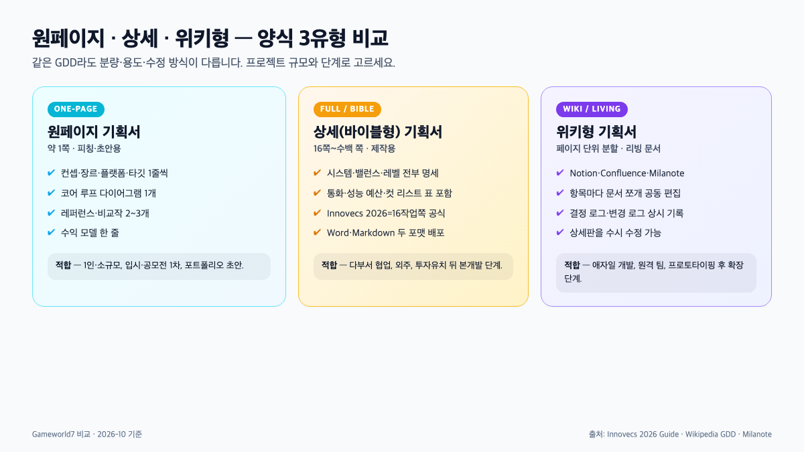
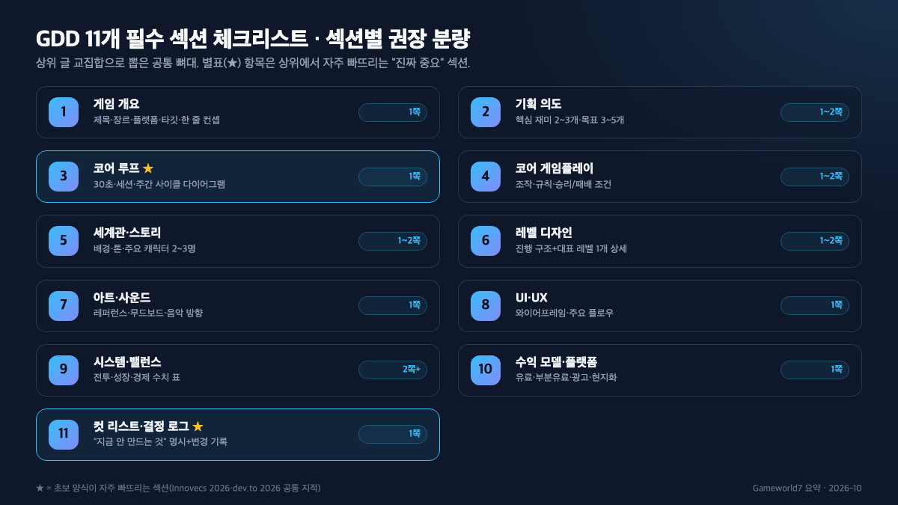

**게임 기획서 양식**을 검색하면 Notion·ClickUp 템플릿 링크부터 쏟아지는데, 정작 "내 프로젝트엔 몇 쪽짜리를 어디서 받아야 하지?"는 답이 잘 안 보여요. 결론부터 말하면 양식은 크게 **원페이지**(1쪽) · **상세**(16쪽~) · **위키형**(분할) 세 가지로 갈리고, 프로젝트 단계마다 쓰는 양식이 다릅니다. 이 글은 2026년 10월 기준으로 세 유형의 차이, 공신력 있는 다운로드처 6곳, 공통 섹션 11개, 섹션별 분량 가이드를 Innovecs 2026 공식 가이드와 한국콘텐츠진흥원 2010 표준양식 연구를 교차해 정리했습니다.

📌 3줄 요약
2026년 흐름은 "짧게 시작 → 리빙 문서로 확장". 1인·공모전은 <b>원페이지 1쪽</b>, 다부서 협업은 <b>Innovecs 2026 16쪽</b> 상세판, 애자일 팀은 <b>Notion·Milanote 위키형</b>이 정답에 가깝습니다.

한국 공식 양식은 <b>한국콘텐츠진흥원 2010 표준양식 개선안</b>과 <b>GIGDC 공모전 양식</b>이 대표적이고, 해외는 Innovecs·Indie Game Academy·Milanote·ClickUp이 무료로 공개돼 있어요.

상위 추천글이 자주 빠뜨리는 섹션 둘은 <b>코어 루프 다이어그램</b>과 <b>컷 리스트(지금 안 만드는 것 목록)</b>입니다. 이 둘이 없으면 양식이 죽은 문서가 돼요.

## 게임 기획서 양식, 뭘로 시작하는 게 맞나요?

**짧은 양식 1쪽부터 시작하세요.** 2026년 Innovecs 공식 가이드와 dev.to 커뮤니티·Wikipedia GDD 문서가 공통으로 권하는 흐름은 "원페이지로 핵심을 못 박고, 결정이 쌓이면 상세·위키형으로 확장"입니다. 처음부터 수백 쪽 바이블형을 목표로 삼으면 쓰다가 지쳐 끝을 못 봐요.

여기서 많이들 헷갈리는데, 양식은 "얇을수록 아마추어, 두꺼울수록 프로"가 아닙니다. Innovecs 2026 가이드는 "작은 팀에선 한 사람이 모든 역할을 겸하므로 솔로 개발자는 원페이지 개요·코어 루프 다이어그램·스코프 리스트면 충분하다"라고 적시해요. 분량은 프로젝트 규모·단계에 맞춰 늘리는 게 정석입니다.

반대로 상용 서비스나 외주·투자 유치 뒤 본개발이 들어가면 1쪽으로는 커뮤니케이션이 안 됩니다. Innovecs 공식 템플릿이 16작업쪽 Word·Markdown 두 포맷으로 배포되는 이유가 여기에 있어요. "스코프를 명시하지 않은 빈 멀티플레이어 쪽은 아직 결정 못 한 신호, 빠진 쪽은 범위 밖이라는 신호"라는 가이드 문구가 상세판의 효용을 요약합니다.

## 원페이지 · 상세 · 위키형 — 양식 3유형 어떻게 다른가요?

**세 유형은 분량보다 용도가 다릅니다.** 원페이지는 피칭·초안용, 상세는 제작·외주 커뮤니케이션용, 위키형은 애자일 팀의 상시 수정용이에요. 이걸 모르고 아무 템플릿이나 받아 쓰면 공들여 쓴 문서가 어디에도 안 맞습니다.

세 유형을 분량·용도·수정 방식으로 묶어보면 이렇습니다.

| 양식 유형 | 분량 | 적합 단계 | 수정 방식 | 대표 템플릿 |
| --- | --- | --- | --- | --- |
| 원페이지(One-Pager) | 1쪽 | 아이디어·피칭·공모전 1차 | 통째로 재작성 | Indie Game Academy One Pager, Innovecs 1-page partner brief |
| 상세(Full/Bible) | 16쪽~수백 쪽 | 본개발·외주·투자 유치 뒤 | 섹션별 버전 관리 | Innovecs 2026 16쪽 템플릿, 한국콘텐츠진흥원 표준양식 |
| 위키형(Wiki/Living) | 분할, 상한 없음 | 애자일 개발·원격 팀 | 상시 공동 편집 | Notion GDD, Confluence, Milanote |

원페이지가 "모자라 보여서" 상세판으로 넘어가고 싶은 유혹이 큰데, dev.to의 2026 템플릿 글은 "**짧은 리빙 문서가 길고 고정된 문서보다 낫다**"라고 못 박습니다. 결정이 늘어나면 섹션을 추가하거나 위키형으로 쪼개면 되고, 처음부터 두꺼운 문서를 안고 가면 수정 비용이 폭발해요.

여기서 "위키형=문서가 아니다"로 오해하기 쉽지만, Milanote는 "브레인스토밍 보드·무드보드·월드빌딩·레벨 디자인·캐릭터 개발" 5개 보드로 뼈대를 미리 깔아두고, Notion GDD는 "요약·목적·배경·프로젝트 정보·컨트롤·게임 루프·레벨·환경·메커닉·규칙/자원"으로 섹션을 템플릿화해 둡니다. 즉 위키형도 양식이 있고, 다만 쪽 단위가 아니라 페이지 단위로 쪼개져 있을 뿐이에요.

## 어디서 받나요 — 공신력 있는 양식 다운로드처 6곳

**한국·해외 각각 세 곳만 알면 충분합니다.** 아래 6곳은 2026년 10월 기준 접속 가능한 공신력 소스로 추렸어요.

**한국 — 공식·공모전 중심**

- **한국콘텐츠진흥원 표준양식 개선안 연구**(KOCCA·2010) — "게임 디자이너가 개발 과정에서 생각해낸 디자인 내용을 체계적으로 정리하고 각 파트별 작업자들에게 올바르게 전달할 수 있도록" 만든 공식 연구 자료입니다. 2010년 발간이지만 뼈대(개요·시스템·화면 기획)의 기준점으로 여전히 유효해요(출처: KOCCA 공식 보고서 PDF).
- **GIGDC**(글로벌 인디 게임제작 경진대회) — 공모전 자료실에서 공식 기획서 양식을 한글·워드 파일로 제공합니다. 공모전 제출용 틀을 그대로 쓰고 싶다면 가장 빠른 길이에요.
- **학교·학원 샘플**(비즈폼 모바일게임 기획서 외) — "타이틀명·기획의도·게임 개요·이 게임의 특징·주요 고객" 5개 섹션 기본형부터 올라와 있습니다. 학생 과제·동아리용으로 가볍게 쓰기 좋아요.

**해외 — 리빙 문서·협업 중심**

- **Innovecs Games 2026 Complete Guide + Free Template** — 16작업쪽, Word·Markdown 두 포맷. 통화 표·성능 예산 표·컷 리스트·변경 로그가 다 비어 있고 한 줄 안내가 붙어 있어 상용 프로젝트에 바로 투입할 수 있습니다.
- **Indie Game Academy — Full GDD + One Pager** — 구글 독스 두 종(Full·One Pager)을 PDF로 받거나 복제해 바로 수정 가능. 북미 인디 커뮤니티 표준처럼 쓰여요.
- **Notion · Milanote · ClickUp** — 위키형·보드형 템플릿 각 1개 이상 무료 공개. ClickUp은 Game Design Document·Storyboard·Design Spec·Creative Brief·Scope of Work 등 8종을 묶어 제공해 팀 협업 쪽에 특히 유용합니다.

양식만 받고 다른 리서치가 궁한 사람이라면 완성한 게임을 어디에 올릴지도 미리 봐두세요. [스팀 공식 스토어](https://store.steampowered.com/)의 소매·심사 요건을 양식 수익모델 섹션에 그대로 반영하면 공모전·투자 피칭에서 질문 폭을 좁힐 수 있습니다.

## 양식에 꼭 들어가는 11개 섹션

**11개 섹션은 상위 글의 교집합입니다.** Innovecs 2026·Indie Game Academy·Notion GDD·한국콘텐츠진흥원 표준양식·bravonglife·prime-career 네 곳 이상이 공통으로 다룬 뼈대만 추렸어요. 이 11개가 다 들어가 있는지만 체크해도 "항목이 뭐 빠졌지?" 하는 불안은 사라집니다.

| # | 섹션 | 여기에 뭘 쓰나 | 권장 분량 |
| --- | --- | --- | --- |
| 1 | 게임 개요 | 제목·장르·플랫폼·타깃·한 줄 컨셉·차별점 | 1쪽 |
| 2 | 기획 의도 | 핵심 재미 2~3개, 주요 목표 3~5개 | 1~2쪽 |
| 3 | **코어 루프** | 30초·세션·주간 사이클 다이어그램 | 1쪽 |
| 4 | 코어 게임플레이 | 조작·규칙·승리/패배 조건 | 1~2쪽 |
| 5 | 세계관·스토리 | 배경·톤·주요 캐릭터 2~3명 | 1~2쪽 |
| 6 | 레벨 디자인 | 진행 구조 + 대표 레벨 1개 상세 | 1~2쪽 |
| 7 | 아트·사운드 | 비주얼 레퍼런스·무드보드·음악 방향 | 1쪽 |
| 8 | UI·UX | 와이어프레임·핵심 플로우 | 1쪽 |
| 9 | 시스템·밸런스 | 전투·성장·경제 수치표(스프레드시트 링크) | 2쪽+ |
| 10 | 수익 모델·플랫폼 | 유료·부분유료·광고, 플랫폼·현지화 범위 | 1쪽 |
| 11 | **컷 리스트·결정 로그** | "지금 안 만드는 것" 명시 + 변경 기록 | 1쪽 |

굵게 표시한 3번(코어 루프)과 11번(컷 리스트·결정 로그) 두 섹션이 **상위 추천 양식에서 자주 빠지는 진짜 중요 항목**입니다. Innovecs 2026 가이드는 컷 리스트 쪽을 "가장 가치 있는 쪽(the most valuable page)"이라 못 박아요. 범위를 못 박아두지 않으면 스코프가 폭발하기 때문입니다.

항목별로 실제 어떻게 채우는지 샘플이 궁금하다면 [게임 기획서 예시 — 항목별 작성법과 실제 채운 샘플](/game-design-document-example/)에서 가상 2D 점프 게임 "네온 점퍼"로 각 칸을 한 줄씩 채워뒀어요. 양식(이 글)과 예시(그 글)를 짝으로 보면 "어떤 뼈대에 어떻게 채우는지"가 한 번에 정리됩니다.

## 섹션별 분량, 몇 쪽씩 나누면 되나요?

**원페이지 양식은 11개를 1쪽에 1~2줄씩, 상세 양식은 11개를 13~17쪽으로 나누는 게 기본값입니다.** brunch(whtdrgon)의 입시용 포트폴리오 가이드와 Innovecs 2026 가이드의 분량 지침을 교차하면 아래 표가 나와요.

| 섹션 | 원페이지 | 입시·학생 상세 | Innovecs 2026 상용 |
| --- | --- | --- | --- |
| 개요·기획 의도 | 1~2줄 | 1+2쪽 | 2쪽 |
| 코어 플레이·루프 | 1줄 + 다이어그램 | 2쪽+1쪽 | 3쪽 |
| 세계관·레벨 | 미기재 또는 1줄 | 1~2 + 2쪽 | 2~3쪽 |
| 아트·사운드·UI | 1줄 + 레퍼런스 2 | 1~2쪽 | 2~3쪽 |
| 시스템·밸런스 | 미기재 | 1~2쪽 | 2쪽+ |
| 수익·플랫폼·일정 | 1줄 | 1~2쪽 | 2쪽 |
| 컷 리스트·결정 로그 | 1줄(스코프) | 0~1쪽 | 1쪽 |

핵심은 "**쓰기 전 분량을 먼저 정하는 것**"입니다. 모집 요강에 페이지 상한이 있는 공모전·입시라면 그 안에서 배분부터 결정하고, 상용 프로젝트라면 Innovecs 2026의 16쪽 베이스를 그대로 쓰고 안 쓰는 쪽만 삭제하는 쪽이 빠릅니다. prime-career의 템플릿 가이드도 "템플릿은 출발점일 뿐 프로젝트 진행 중 진화해야 한다"라고 강조해요.

## 학생·포트폴리오용 양식과 평가 3단계

**학생 양식은 평가 3단계를 거꾸로 쓰면 됩니다.** brunch(whtdrgon)의 입시용 가이드는 실기평가가 "① 초급 — 논리적 전개와 기본 구조, ② 중급 — 요소 간 정합성, ③ 고급 — 기술적 실현성" 3단계로 올라간다고 적습니다. 앞 단계가 흔들리면 뒤 단계는 평가 대상도 안 돼요.

그래서 포트폴리오 양식은 "읽는 사람이 10초 안에 이해"를 1순위로 둡니다. 맨 앞에 **로그라인**(게임을 한 문장으로 요약한 문구)을 두고, 타깃 유저를 나이·플레이 시간·상황까지 쓴 페르소나 1인으로 좁히는 게 요즘 입시 통용이에요. 중요한 정보를 먼저, 세부는 뒤에 두는 피라미드 구조로 쓰고, 텍스트만 빼곡히 채우기보다 코어 루프 다이어그램·레벨 플로우차트·간단한 스케치를 곁들이세요.

학생 양식 분량 분배는 brunch 가이드 기준으로 **개요 1쪽 → 기획 의도 2쪽 → 메커니즘 2쪽 → 세계관 1~2쪽 → 레벨 2쪽 → 캐릭터·아이템 2쪽 → UI 1쪽** 순이 안전합니다. 모집 요강에 페이지 제한이 있다면 "상식적으로 접근하라"는 원 저자의 조언을 그대로 따르는 게 좋아요.

## 양식을 다운받고도 못 채우는 3가지 실수

**양식만 받고 멈추는 사람은 거의 같은 세 지점에서 막힙니다.** 알고 피하면 완성도가 눈에 띄게 올라가요.

**첫째, 다양한 요소를 재미로 착각합니다.** 양식의 '기획 의도' 칸에 "다양한 무기, 다양한 스킬"을 잔뜩 적는데, 다양함은 핵심 하나가 작동한 뒤에 의미가 있습니다. prime-career 가이드도 "역할별 접근 — 대상 청중과 플랫폼을 명시적으로 설정하라"라고 지적해요. 핵심 재미 2~3개를 먼저 뾰족하게 다듬고, 다양함은 그 변주로 적으세요.

**둘째, 추상 표현으로 채웁니다.** "흥미진진한 전투" 같은 문구는 개발자가 못 만듭니다. dev.to의 2026 가이드는 "**모호한 바람 대신 확정된 결정을 적으라**"라고 강조해요. "턴제, 매 턴 액션 포인트 3개 소모, 처치 시 코인 2~5 드랍"처럼 수치·규칙으로 바꿔야 양식이 설계도가 됩니다.

**셋째, 코어 루프와 컷 리스트를 비웁니다.** 11개 섹션 중 가장 자주 비는 두 칸이에요. 코어 루프가 비면 재미 가설이 없는 거고, 컷 리스트가 비면 범위가 끝없이 늘어납니다. Innovecs 2026은 "스코프 크립을 막는 가장 가치 있는 쪽"이 컷 리스트라고 못 박아요.

⚠️ "흥미진진한 전투" 금지
양식 칸에 형용사를 쌓지 말고 숫자·규칙으로 바꾸세요. 수치가 들어가야 개발자·아티스트가 실제로 만들 수 있습니다. 수치 두 개 이상이면 평균적인 공모전 1차는 통과입니다.

## 양식을 '죽은 문서'로 만들지 않는 법 — 리빙 문서·결정 로그·컷 리스트

**양식은 완성하는 게 아니라 운영하는 겁니다.** Wikipedia GDD 문서는 "GDD는 리빙 문서(living document)로, 개발하면서 계속 개선된다"라고 정의합니다. 처음 쓴 상태로 책상 서랍에 들어가면 양식의 기능이 0이 돼요.

운영의 핵심은 세 가지입니다. **① 결정 로그** — "왜 턴제를 리얼타임으로 바꿨는지"를 날짜·사유와 함께 적어두면 팀원이 반복 질문하지 않아요. ② **변경 로그** — 어느 섹션을 언제 고쳤는지 쪽마다 기록. Innovecs 2026 템플릿은 아예 변경 로그 쪽을 별도로 끼워 넣습니다. ③ **컷 리스트** — "이번 버전에서는 만들지 않음"을 명시해 범위를 묶어둡니다.

위키형 양식(Notion·Confluence·Milanote)이 2026년에 떠오른 이유도 이것입니다. 섹션이 페이지로 쪼개져 있어서 수정이 쉽고, 수정 이력이 자동으로 남아요. Milanote 가이드가 "브레인스토밍 보드·무드보드·월드빌딩·레벨 디자인·캐릭터 개발" 다섯 보드를 미리 깔아두는 것도 "리빙 문서로 유지"를 전제한 설계입니다.

💡 결정 로그 한 줄 형식
<b>[날짜] 섹션 — 결정: 턴제→리얼타임. 이유: 플레이테스트 3회에서 긴장감 평균 2.1/5. 다음 액션: 전투 수치 재설계.</b> 이 한 줄만 쌓여도 양식이 산 문서가 됩니다.

## 한눈에 정리 — 상황별 양식 선택표

**내 상황 줄만 찾으면 됩니다.** 세 유형과 11개 섹션을 머리에 넣고 나면 아래 표 한 줄로 결정이 끝납니다.

| 상황 | 추천 양식 | 어디서 받나 |
| --- | --- | --- |
| 혼자 아이디어 피칭 | 원페이지 1쪽 | Indie Game Academy One Pager |
| 공모전·입시 포트폴리오 | 입시용 상세(13~17쪽) | GIGDC 공식 양식, brunch 입시 가이드 참고 |
| 1인·소규모 본개발 | 원페이지 + 위키형 분할 | Notion GDD, Milanote |
| 다부서·외주 본개발 | Innovecs 2026 16쪽 | Innovecs 2026 Guide 공식 |
| 투자 유치·사업계획 병행 | 상세 + ClickUp 세트 | ClickUp 템플릿 8종 |
| 한국 공식 틀이 필요 | KOCCA 표준양식 기반 | KOCCA 2010 연구 보고서 |

이거 하나만 기억하면 돼요. **양식은 완성하는 문서가 아니라 결정이 쌓이면 늘어나는 설계도**라는 것. 1쪽부터 시작해서 결정 로그·컷 리스트를 함께 운영하면, 작은 양식 하나로도 프로젝트가 끝까지 갑니다.

## 자주 묻는 질문 (FAQ)

**Q. 게임 기획서 양식은 무조건 상세한 게 좋나요?** 아닙니다. Innovecs 2026 가이드와 dev.to 2026 템플릿 글은 공통으로 "짧은 리빙 문서가 길고 고정된 문서보다 낫다"라고 못 박습니다. 아이디어·피칭 단계라면 원페이지 1쪽, 본개발 단계라면 16쪽 전후 상세판, 애자일 팀이면 위키형이 각각 정답에 가깝습니다.

**Q. 한국어 공식 양식은 어디서 받나요?** 한국콘텐츠진흥원이 2010년 발간한 "게임 기획서 표준양식 개선안에 관한 연구" 보고서가 공식 기준점이고, 공모전 양식은 GIGDC(글로벌 인디 게임제작 경진대회) 자료실에서 한글·워드 파일로 받을 수 있어요. 학생·동아리용 간단 양식은 비즈폼 서식 등에서 5개 섹션 기본형으로 올라와 있습니다.

**Q. 양식에서 가장 중요한 섹션은 뭔가요?** 코어 루프와 컷 리스트입니다. 코어 루프(행동→보상→강화)는 재미의 뼈대라 비어 있으면 다른 칸이 아무리 화려해도 게임이 흔들리고, 컷 리스트(지금 안 만드는 것)는 스코프 크립을 막는 가장 가치 있는 쪽이라고 Innovecs 2026이 명시합니다. 이 둘은 상위 추천 양식에서도 자주 빠지는 자리라 직접 챙기세요.

**Q. 양식을 받고도 못 채우겠어요. 뭐부터 할까요?** 11개 섹션 중 1·2·3번(개요·기획 의도·코어 루프)만 먼저 완성하세요. 원페이지에 그 세 칸만 1줄씩 적어도 "무슨 게임인지"가 전달됩니다. 나머지 칸은 결정이 쌓이는 대로 채우는 리빙 문서 방식이 2026년 공식 흐름이에요. 실제로 각 칸을 어떻게 채우는지는 [게임 기획서 예시](/game-design-document-example/)의 네온 점퍼 샘플이 가장 빠른 참고가 됩니다.

**Q. 상용·공모전·학생용 양식의 차이가 뭔가요?** 분량과 "읽는 대상"이 다릅니다. 상용은 다부서 커뮤니케이션이 목적이라 수치·표가 많은 16쪽형, 공모전은 심사위원이 10초 안에 핵심을 보게 설계한 1쪽+보강 자료형, 학생·입시는 평가 3단계(논리→정합성→실현성)를 거꾸로 쓴 13~17쪽 포트폴리오형이 안전합니다.

---

**관련 키워드** — #게임기획서양식 #게임기획서템플릿 #GDD양식 #원페이지기획서 #게임기획서다운로드 #한국콘텐츠진흥원기획서 #GIGDC기획서양식 #Innovecs2026GDD #게임기획서11개섹션 #리빙문서 #컷리스트 #게임기획서포트폴리오
