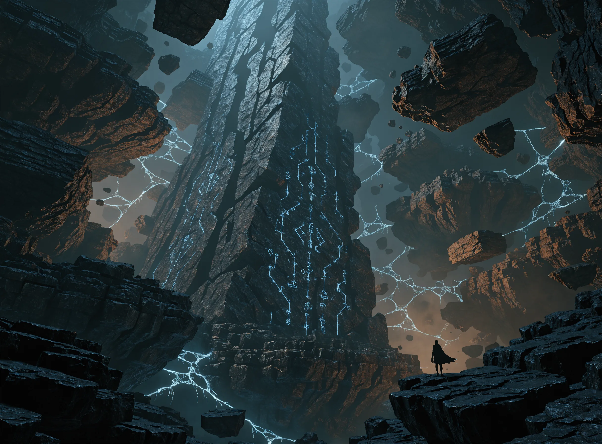
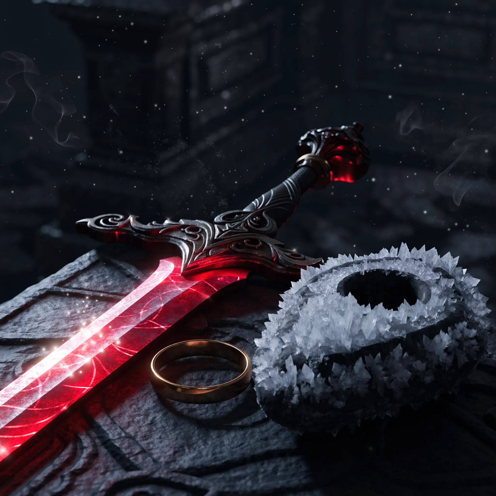

라스트에폭 보스 드랍템은 구조만 알면 간단합니다. 타임라인 보스마다 전용 유니크가 정해져 있어요. 그중 둘은 짝이라 매번 하나가 확정으로 나오고 나머지는 부패도와 아이템 희귀도를 올릴수록 잘 나옵니다. 결론부터 말하면요, 원하는 아이템이 나오는 보스를 이 글의 표에서 찾은 다음 강화 모노리스에서 그 보스만 반복하는 게 정답이에요. 저도 처음엔 디시 갤러리와 해외 포럼을 오가며 "이 템 어디서 나와요"를 하나씩 검색했는데, 한국어로 보스별 드랍을 전부 모아둔 표가 없더라고요. 그래서 맥스롤 치트시트 최신판과 라스트 에포크 툴즈, 국내 커뮤니티 정리를 대조해서 시즌 5 기준으로 직접 묶었습니다. 이 글 하나 저장해두면 파밍할 때마다 다시 검색할 일은 없을 겁니다.

📌 3줄 요약 (2026년 10월 · 시즌5 기준)
타임라인 보스는 전용템 중 <b>2종 가운데 1개를 매번 확정</b>으로 떨구고, 나머지 희귀템은 <b>부패도·아이템 희귀도</b>가 높을수록 잘 나옵니다.

상당수 보스 전용템은 <b>강화 모노리스</b>에서만 나오니, 일반 타임라인에서 안 나온다고 헤매지 마세요.

오로비스의 그림자는 <b>부패도 50·120·200</b>을 넘겨야 드랍 목록이 하나씩 열립니다.

## 보스 전용 드랍은 어떻게 정해져 있나요?

보스 전용 유니크는 그 보스 말고는 어디서도 나오지 않습니다. 라스트에폭의 유니크는 크게 두 종류로 나뉘는데, 아무 데서나 뜰 수 있는 월드 드랍과 특정 보스의 전리품 목록에 묶인 보스 전용 드랍이에요. 빌드 가이드에 적힌 핵심 장비가 몇 주를 돌아도 안 보였다면, 월드 드랍이 아니라 보스 전용이라서 그랬을 확률이 높습니다.

타임라인 보스의 전리품은 패턴이 똑같습니다. 전용템 중 두 개가 짝으로 묶여 있어서 보스를 잡을 때마다 둘 중 하나는 반드시 나오고 나머지 전용템은 낮은 확률로 추가됩니다. 해외 포럼에서 개발진 답변까지 확인해 보니, 이 확정 짝은 아이템 희귀도의 영향을 받지 않고 희귀 드랍만 영향을 받는다고 해요. 공식 포럼에서 개발진에게 확인했다는 유저 답변을 옮기면 "축복은 유니크가 될 확률 자체를 바꾸지 않고, 떨어지는 장비의 수를 늘려줄 뿐"이라고 해요. 유저 전언이라 단정까지는 어렵지만, 축복만 믿고 드랍률이 뛰길 기대하지 않는 편이 안전합니다.

그리고 많은 분들이 놓치는 전제가 하나 있어요. 희귀 전용템 상당수는 강화 모노리스에서만 나옵니다. 강화 모노리스를 해금하기 전까지는 목록 자체에 없는 셈이라서 — 공식 지원 페이지 기준으로 첫 캐릭터는 레벨 90 타임라인 셋을, 부캐릭터는 하나만 정복하면 열립니다 —, 일반 타임라인에서 수십 번을 돌아도 못 봅니다.

## 타임라인 보스별 전용 드랍 한눈에 보는 표

아래 표가 이 글의 본체입니다. 보스·선구자 이름은 국내에서 통용되는 한국어 표기, 아이템은 검색 편의를 위해 영문 그대로 적었습니다. 라스트 에포크 툴즈에서 영문명으로 검색하면 한국어 옵션까지 바로 나와요.

| 타임라인 | 보스 | 확정 드랍 (둘 중 1개) | 희귀 드랍 |
| --- | --- | --- | --- |
| 추방자의 몰락 | 어보미네이션 | Woven Flesh / Ribbons of Blood | Flayer's Pride, Strands of Souls |
| 훔쳐진 창 | 신 사냥꾼 아르헨투스 | Fragments of the Shattered Lance / Shard of the Shattered Lance | Throne of Ambition, Wings of Argentus |
| 흑태양 | 검은 태양 라예 | Atrophy / Dark Shroud of Cinders | Eternal Eclipse, The Confluence of Fate |
| 피, 서리, 그리고 죽음 | 망령 포르모수스 | Last Steps of the Living / Frozen Eyes of Formosus | Frostbite Shackles, Eulogy of Blood, Lich's Scorn |
| 폭풍의 종말 | 폭풍의 신 라곤 | Alluvion / Coral Aegis | Stormcarved Testament, Eye of Storms |
| 제국의 몰락 | 하튼의 껍데기 | Bulwark of the Last Abyss / Trident of the Last Abyss | Nightbringer, Anchor of Oblivion |
| 드래곤의 통치 | 시체의 황제 | Dragonflame Edict / Symbol of Demise | Twisted Heart of Uhkeiros, Horns of Uhkeiros |
| 마지막 폐허 | 가스파르 장로의 껍데기 | Gaspar's Acuity / Gaspar's Will | Gaspar's Insight, Sacrificial Embrace |
| 겨울의 시대 | 헤오롯 | Call of the Tundra / Reign of Winter | Yulia's Path, Faith of the Frozen |
| 화염의 정령 | 화산 주술사 | Bhuldar's Wrath / Herkir's Vessel | Logi's Hunger, Trinity of Flames |

표를 직접 만들면서 알게 된 소소한 함정도 하나 적어둘게요. 툴즈 한국어 번역은 화염의 정령 타임라인을 불의 정령으로 적는 식의 어긋남이 있습니다. 인게임 표기와 조금 달라도 같은 타임라인이에요. 그리고 장갑 유니크 Ravenous Void는 원래 월드 드랍이지만 강화 가스파르가 더 높은 확률로 떨구고 아이템 희귀도의 영향도 받습니다.

## 선구자가 떨구는 전용 아이템은 뭔가요?

선구자는 타임라인마다 한 명씩 배정돼 있고 각자 전용 유니크를 하나씩 들고 있습니다. 강화 타임라인 보스를 잡은 뒤 등장하는 이 추가 보스들은 공통 재료와 함께 전용템을 떨궈요.

| 선구자 | 전용 드랍 | 나오는 타임라인 |
| --- | --- | --- |
| 모독의 선구자 | Aberroth's Command | 추방자의 몰락 |
| 오만의 선구자 | Phase Point | 훔쳐진 창 |
| 증오의 선구자 | World Splitter | 흑태양 |
| 전쟁의 선구자 | Celestial Doom | 피, 서리, 그리고 죽음 |
| 혼돈의 선구자 | Black Blade of Chaos | 폭풍의 종말 |
| 배신의 선구자 | Wall of Nothing | 제국의 몰락 |
| 파괴의 선구자 | Event Horizon | 드래곤의 통치 |
| 공포의 선구자 | The Inevitable | 마지막 폐허 |
| 포학의 선구자 | Bane of Winter | 겨울의 시대 |
| 잿더미의 선구자 | Flames of Midnight | 화염의 정령 |

열 명 전부 선구자의 눈과 바늘, 시간의 초석 같은 공통 전리품도 떨굽니다. 선구자의 눈은 뒤에 나올 아베로스 소환 재료라서 버리면 안 돼요.

## 오로비스의 그림자는 부패도 몇부터 템이 나오나요?

오로비스의 그림자는 부패도 구간을 넘겨야 드랍 목록이 열립니다. 아무 부패도에서나 나오는 건 Siphon of Anguish와 Stymied Fate 두 개뿐이고 나머지는 이렇게 잠겨 있어요.

| 아이템 | 필요 부패도 |
| --- | --- |
| Siphon of Anguish, Stymied Fate | 제한 없음 |
| Apathy's Maw | 50 이상 |
| Shattered Chains | 120 이상 |
| Omnis | 200 이상 |

치트시트를 대조하다 알았는데 부패도 200을 못 넘기면 Omnis는 애초에 목록에 없는 아이템이더라고요. 저도 이걸 몰랐다면 100 언저리에서 하염없이 기다릴 뻔했어요. 드랍 확률은 부패도가 높을수록, 그리고 에코 웹 중심에서 멀리 떨어진 그림자일수록 올라갑니다. 망각의 합류점에서 잡으면 거리와 무관하게 더 높은 확률이 적용되고요.

## 던전 보스 유니크는 어디서 확인하나요?

던전 세 곳은 각각 열쇠로 입장하며 보스마다 전용 유니크가 네 종씩 있습니다. 시간의 성소의 크로노맨서 율라는 Julra's Stardial, Somnia, Julra's Obsession, Vessel of Strife를 떨굽니다. 소울파이어 바스티온의 크레모루스에게서는 Ashes of Mortality, Lich's Envy, Immolator's Oblation, Pyre of Affliction이 나와요. 라이트리스 아버의 산 아래 잠든 자는 Peak, Foot, Face, Core of the Mountain 네 형제를 냅니다.

던전은 티어가 높을수록 상위 보상이 나오지만 하위 아이템도 같이 나올 수 있어요. 하위 티어일수록 그 티어 아이템의 드랍률이 좋습니다. 직조공 패시브의 와든 에코 노드를 찍으면 던전 전용 몬스터가 모노리스에도 출현하니, 던전 왕복이 귀찮은 분들은 이 경로도 열어두세요.

## 시즌 5 신규 보스 드랍 — 모르디타스와 아베로스

시즌 5 서리화신의 분노의 주인공 모르디타스는 드랍 확률까지 공개돼 있습니다. 얼어붙은 피의 서클에서 만나는 모르디타스는 Frostborn Solitude 80%, Heorot's Repose 20%, Withstand the Elements 50%에 소환 재료인 Demigod's Ascendance를 확정으로 떨궈요. 그 재료로 여는 피나클 모르디타스는 Vestige of Imprisonment 80%, Morditas' Vengeance 20%, Unsated Rage 50%입니다. 일반 모르디타스가 있는 얼어붙은 피의 서클은 모르디타스의 분노 처치 4,000을 쌓아야 열리고, 피나클은 일반 모르디타스가 떨구는 Demigod's Ascendance로 입장하니, 시즌 기믹을 꾸준히 돌리는 게 곧 보스 파밍 준비예요.

엔드게임 정점 보스 아베로스도 수치가 명확합니다. 영문명은 Aberroth이고 현재 공식 한국어 표기는 아베로스입니다. 초기 한글화에서는 아플로스라는 오역 표기가 쓰여서 옛 커뮤니티 글에는 그 이름도 남아 있어요. 산산조각 난 길의 망각의 제단에서 선구자의 눈으로 소환합니다. Threshold of Eternity는 100% 확정이고 Null Portent 47.62%, Seed of Ekkidrasil 38.1%, Nihilis 14.29% 순서로 귀해져요. 확정 드랍 Threshold of Eternity로는 우버 아베로스에 도전할 수 있고, 거기서는 Immortal Vise 80%와 Shattered Worlds 20%가 걸려 있습니다. 선구자 전용템 전부를 아베로스도 떨굴 수 있다는 점은 의외로 덜 알려진 사실이에요.

## 목표 아이템별로 어디를 돌아야 하나요?

원하는 게 뭐냐에 따라 코스가 갈립니다. 특정 보스 전용템이 목표라면 위 표에서 보스를 찾아 그 타임라인만 파고 에코는 보스 소환에 필요한 안정성만 채우는 최단 동선으로 돌면 됩니다. 부패도를 올려두면 필요한 에코 수가 줄고 희귀 드랍률은 올라가니 일석이조예요. 월드 드랍 유니크가 목표라면 보스 반복보다 부패도 자체를 올리면서 원하는 부위를 주는 특별 에코 보상을 모는 쪽이 빠릅니다.

갓 강화 모노리스에 입성한 분들께는 저라면 이렇게 권하고 싶어요. 먼저 빌드에 필요한 보스를 표에서 딱 하나 정한 뒤 그 타임라인에서 부패도 200까지는 오로비스의 그림자를 쫓으며 올립니다. 그 과정에서 안정성이 쌓여 보스 트라이 횟수도 자연히 늘어나요. RPG 파밍 루프에 익숙하지 않다면 [RPG 게임 추천 글](/rpg-game-recommendations/)에서 장르 감각부터 잡고 와도 좋습니다.

💡 검색 꿀팁
아이템 이름만 알면 <b>라스트 에포크 툴즈</b>에서 드랍처를 역으로 찾을 수 있습니다. 상단에서 언어를 ko로 바꾸면 한국어로도 보여요.

개별 아이템의 세부 옵션과 드랍처 역검색은 [라스트 에포크 툴즈 아이템 DB](https://www.lastepochtools.com/db/)가 가장 정확합니다. 패치마다 수치가 바뀌니 큰 결정 전에는 한 번씩 교차 확인하는 습관을 권해요.

## 자주 묻는 질문

**Q. 보스 전용 유니크는 일반 타임라인에서도 나오나요?** 확정 드랍 짝과 일부 희귀템은 일반에서도 나오지만 상당수 희귀 전용템은 강화 모노리스 전용입니다. 목표템이 안 보이면 먼저 강화 여부부터 확인하세요.

**Q. 부패도를 올리면 모든 드랍이 좋아지나요?** 희귀 보스 전용템과 유니크 에코 보상 확률은 올라가지만 둘 중 하나 확정으로 나오는 짝 드랍은 부패도나 아이템 희귀도의 영향을 받지 않습니다.

**Q. 아베로스는 어떻게 소환하나요?** 강화 타임라인의 선구자들이 떨구는 선구자의 눈을 모아 산산조각 난 길의 망각의 제단에서 사용하면 됩니다. 잡으면 확정으로 나오는 Threshold of Eternity가 우버 아베로스 입장권이에요.

**Q. 전설적 잠재력이 붙은 보스템은 어떻게 노리나요?** 잠재력은 드랍 순간 무작위라 저격이 안 됩니다. 대신 부패도가 높을수록 잠재력 확률이 조금씩 오르고 네메시스의 알에 잠재력 없는 유니크를 넣어 부여를 노리는 우회로가 있어요.

---

**관련 키워드** — #라스트에폭보스드랍 #라스트에폭유니크파밍 #라스트에폭타임라인보스 #라스트에폭모노리스 #라스트에폭부패도 #강화모노리스 #오로비스의그림자 #라스트에폭시즌5 #모르디타스 #라스트에폭아베로스 #라스트에폭던전유니크 #라스트에폭표적파밍
