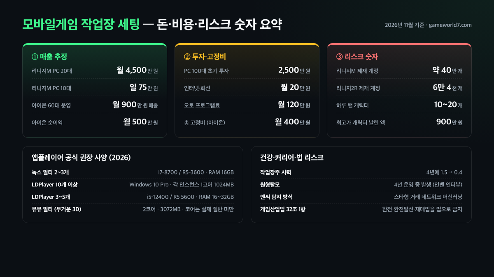
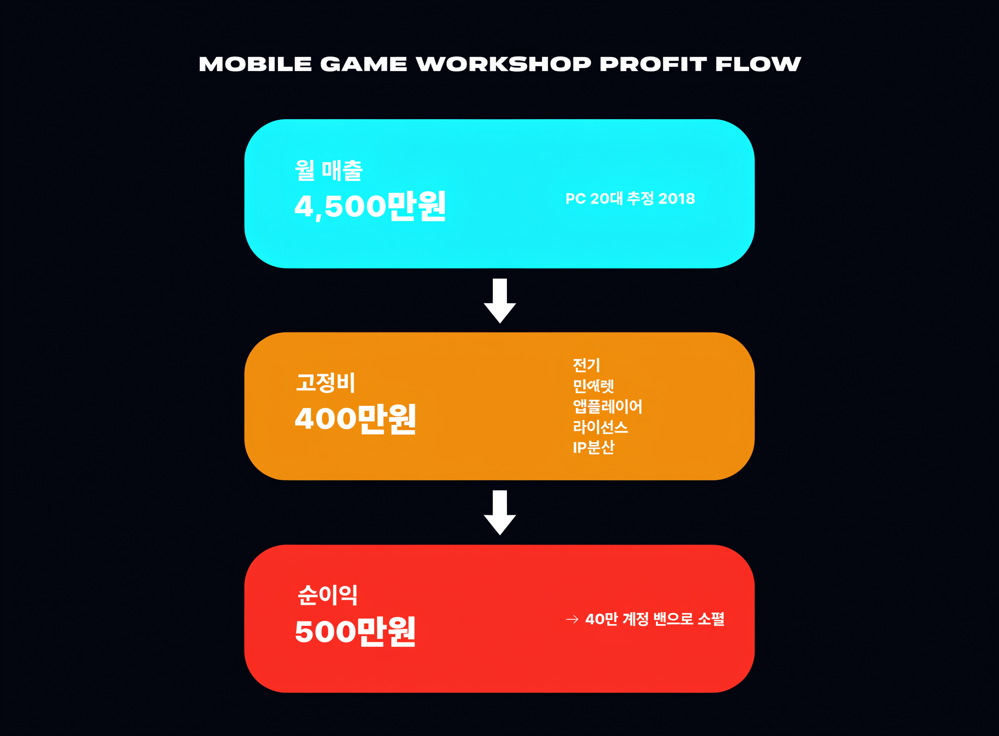

**모바일게임 작업장 세팅**이 뉴스에 다시 떠오를 때마다 가장 먼저 보이는 숫자가 "리니지M 작업장 월 4,500만 원"이에요. 결론부터 말씀드리면 이 숫자는 광고도 아니고 완전히 거짓도 아니지만, 그 뒤에 걸린 100대 PC·2,500만 원 투자·40만 계정 제재·시력 1.5→0.4라는 다른 숫자들을 같이 보지 않으면 전부 환상입니다. 이 글은 2026년 11월 기준으로 녹색경제신문·바이라인네트워크·게임메카·인벤 작업장주 인터뷰·녹스·LDPlayer·뮤뮤 공식 가이드를 교차해 작업장 세팅의 실제 구조와 리스크를 숫자로 정리했어요.

📌 3줄 요약 (2026년 11월 기준)
리니지M 기준 월 수익 추정은 1인 작업장 <b>월 4,500만 원</b> 수준(녹색경제신문 2018 보도)이지만, 엔씨소프트가 작업장 혐의로 제재한 계정만 <b>약 40만 개</b>·리니지2 레볼루션 <b>6만 4천 개</b>라 큰손 운영자부터 날아갑니다(게임메카).

하드웨어는 녹스·LDPlayer·뮤뮤 공식 가이드 기준 멀티 2~3개에 <b>i7-8700/R5-3600 이상·RAM 16GB</b>, 멀티 3~5개부터는 <b>RAM 32GB</b>가 사실상 기준선입니다.

법적으로는 게임산업법 32조가 '유통질서 저해'를 금지하지만 작업장 자체를 처벌하는 조항은 없어, 리스크는 처벌이 아니라 <b>대규모 밴·건강 악화</b>로 돌아옵니다.

## 모바일게임 작업장 세팅, 간단히 말해 뭔가요?

**모바일게임 작업장은 PC에 앱플레이어 수십 개를 띄워 자동으로 재화·아이템을 모으고 현금화하는 집단 또는 개인입니다.** 과거 PC 온라인게임 시대부터 있었지만, 모바일 자동전투가 보편화되면서 "조직이 아닌 개인이 운영하는 사례도 심심찮게 적발"된다고 게임메카가 2022년 보도했어요. 즉 2026년의 작업장은 뒷방 PC방이 아니라, 평범한 아파트 방 하나에 PC 몇 대만 있어도 성립하는 구조입니다.

여기서 많이 헷갈리는데, 작업장은 '매크로를 돌리는 모든 유저'가 아니라 "모은 재화를 소수의 캐릭터에 무상으로 몰아주고 그 캐릭터로 거래소에서 현금화"하는 수익 구조를 가진 운영자들을 가리켜요. 바이라인네트워크 2020년 보도에 따르면 엔씨소프트는 이 구조를 "스타형 거래 네트워크"라고 부릅니다. 재화를 중심 캐릭터 하나로 몰아주는 모양이 별 모양처럼 보여서 붙은 이름이에요.

이 글에서 쓰는 '세팅'이라는 말은 작업장을 돕는 노하우가 아니라, 공개 보도·공식 매체·운영자 인터뷰에서 드러난 하드웨어·소프트웨어·운영 구조와 그에 따른 리스크를 분해하는 뜻이에요. 돈벌이 가이드로 읽으면 뒤에 나오는 "4년에 원형탈모·시력 1.5→0.4" 같은 숫자가 왜 거기 있는지 놓치게 됩니다.

## 왜 '월 4,500만 원'이 환상인지부터 — 공개된 숫자 뜯어보기

**녹색경제신문이 2018년 8월 보도한 "리니지M 작업장 월 4,500만 원"은 PC 20대·캐릭터 100개 이상 기준의 매출 추정치입니다.** 보도 내용을 요약하면 PC 10대로 하루 75만 원, 20대로 하루 150만 원, 월 환산 4,500만 원이에요. 비슷한 시기 헝그리앱 커뮤니티 게시글에서도 "매크로 작업장 한 달 수익 5천만 원"이라는 유사 추정이 돌았습니다. 다만 이 숫자는 **2018년 당시 매출 추정**이며, 2026년의 투자비(앱플레이어·PC 재구성)·고정비(전기·IP 분산)·대규모 밴 리스크를 반영하면 체감 수치는 더 아래로 내려간다는 전제를 깔고 봐야 해요.

그런데 이 숫자는 '매출'이고, 2007년 인벤이 공개한 아이온 작업장주 인터뷰에서는 "오토 캐릭터 1개 하루 5천 원 기준·60대 운영 시 월 매출 900만 원에서 고정비 400만 원 빼면 순이익 500만 원"이라고 적시해요. 즉 하드웨어·전기·인터넷·오토 프로그램 사용료가 매출의 절반 가까이를 먹습니다. 모바일 시대로 와도 통신료·VPN·앱플레이어 비용·IP 분산 비용이 늘어, '매출 X 수익률 50%' 공식은 크게 달라지지 않아요.

여기에 밴 리스크를 반영하면 숫자는 또 떨어집니다. 같은 인벤 인터뷰에서 운영자는 "하루에 10개, 20개도 블록 당해봤다"고 밝혔고, "900만 원짜리 캐릭터도 블록된 적 있다"고 했어요. 게임메카 보도 기준 리니지M만 약 40만 계정, 리니지2 레볼루션 6만 4천 계정이 작업장 혐의로 이용 제재를 받았습니다. 큰손 운영자가 하루아침에 날아가는 사례가 많아, 2026년에도 '월 4,500만 원'을 그대로 벌 수 있다는 전제는 비현실적입니다.

## 하드웨어 세팅 — 앱플레이어 공식 권장 사양 2026

**멀티 인스턴스 2~3개부터 시작해 10개를 넘어가면 사실상 전용 PC가 필요합니다.** 녹스 공식 지원 페이지 기준 멀티 2~3개 추천 사양은 Intel Core i7-8700 또는 AMD R5-3600 이상, 메모리 16GB, SSD 256GB, 그래픽 GTX 760·R9 280 이상이에요. 32비트 윈도우는 메모리 제한으로 멀티 2개 이상이 불가능하다고도 못 박습니다.

LDPlayer 공식 가이드는 더 세분화돼 있습니다. "10개 이상을 구동하려면 Windows 10 Pro를 권장"하고, 각 인스턴스는 "1코어·1024MB"에서 시작해 문제 생기면 한 단계씩 올리는 식이에요. 멀티 3~5개 운영 시 외부 가이드들은 Intel i5-12400·AMD 라이젠 5 5600급 6코어 12스레드와 RAM 16~32GB를 기준선으로 제시하고, LDPlayer 멀티 인스턴스 매니저 공식 FAQ는 "3D 게임이 로드된 인스턴스는 2~4GB RAM 소비"를 전제로 32GB RAM을 멀티 2~3개 이상에 권장합니다.

뮤뮤 앱플레이어 2026 공식 세팅 가이드는 멀티 모드에서 자동사냥 2D 1코어 1~2GB, 일반 2D 1코어 2GB, 가벼운 3D 2코어 2GB, 무거운 3D 2코어 3GB로 안내해요. 특히 "선택한 코어 수가 실제 코어 수의 절반보다 적어야 한다"는 원칙은 상용 작업장 세팅에서도 통용되는 수치여서, 8코어 CPU로 4개 이상 안정 운용이 어렵다는 뜻이 됩니다.

세 앱플레이어 공식 수치를 한눈에 비교하면 아래와 같습니다.

| 앱플레이어 | CPU 권장 | RAM 권장 | 멀티 2~3개 기준(인스턴스당) | 멀티 5개+ 기준 | 공식 OS 권장 |
| --- | --- | --- | --- | --- | --- |
| 녹스 | i7-8700 또는 R5-3600 이상 | 16GB 이상 | 1~2코어·2GB(2~3개 기준 공식 추천) | 전용 PC + RAM 32GB급 권장(32비트 OS는 멀티 2개 이상 불가) | 64비트 Windows 7/8/10 |
| LDPlayer | 외부 가이드 기준 i5-12400·R5 5600급 6코어 12스레드 | 16~32GB(3D 인스턴스 2~4GB 소비 전제) | 각 인스턴스 1코어·1024MB에서 시작해 상향 | **10개 이상은 Windows 10 Pro 권장**(공식 가이드) | Windows 10 이상(10개↑ Pro) |
| 뮤뮤 | 2D 1코어·3D 2코어 전제 | 2D 1~2GB·3D 2~3GB(인스턴스당) | 가벼운 3D 2코어 2GB / 무거운 3D 2코어 3GB | **"선택 코어 수 < 실제 코어의 절반"**(8코어 CPU에서 4개↑ 안정 운용 어려움) | Windows 10/11 |

여기서 보이는 공통 결론은 '멀티 5개를 넘어가는 순간부터는 일반 게이밍 PC 1대로 안 된다'는 거예요. 2026년 11월 기준 다나와·에누리 등 가격비교 사이트와 조립 커뮤니티에서 거론되는 i5-12400·RAM 32GB·NVMe 500GB·GTX 1660 Ti급 세팅은 대체로 100~140만 원대 사이에서 왔다 갔다 하는데, 운영자 입장에서 보면 PC 10대를 들이는 데에만 투자비 1,000만 원 안팎이 선지출로 나갑니다(견적은 CPU·GPU 시세에 따라 월 단위로 꽤 흔들리니 특정 숫자로 단정하기는 어렵습니다).

## 소프트웨어 세팅 — 매크로·자동전투·탐지 회피 패턴

**모바일게임 작업장은 '매크로'보다 '게임의 공식 자동전투'를 먼저 이용합니다.** 게임메카 보도의 설명대로 "자동전투 기능을 공식적으로 지원하고 장소와 장비 면에서도 규모가 작아진" 모바일 환경에서는 비인가 오토 프로그램 없이도 사냥만 돌리는 수준이 가능해요. 그 위에 매크로·자동 접속 복구·일괄 로그인 전환 같은 유틸이 얹히는 구조입니다.

작업장 세팅의 숨은 디테일은 '사냥터 로테이션'이에요. 인벤 작업장주는 "레벨마다 어디서 사냥해야 제일 레벨업이 잘되고 템이 잘 나오는지 생각해서 60개를 일일이 놔둬야 한다"고 설명합니다. 캐릭터별 시간대·사냥터·스킬 순서를 사람 손으로 짜지 않으면 그냥 자동사냥을 돌려도 "한 달에 몇만 원도 못 벌어 가는" 수준에 그친다는 뜻이에요. 아이온 사례지만 2026년 모바일 MMO에서도 큰 틀은 같습니다.

탐지 회피 쪽에서는 IP 분산·휴대폰 인증 우회·거래 패턴 분산이 핵심 변수입니다. 게임메카는 "에오스 레드가 각 서버 최초 접속 시 휴대폰 인증을 도입해 복수 계정 생성을 차단했다"고 밝혔고, 모바일게임 다수가 비슷한 길을 걷고 있어요. 다만 모바일은 "비인가 오토 프로그램 추적이 PC보다 어렵다"는 한계도 보도에 적시돼 있어, 운영자와 게임사 모두 '사람 눈'보다 다음 섹션의 머신러닝에 의존합니다.

바이라인네트워크·게임메카·인벤 작업장주 인터뷰에 반복해서 등장하는 '운영 변수'를 정리하면 아래 체크리스트처럼 묶이는데, 세팅 글이라는 키워드로 검색해 들어오는 독자가 가장 많이 묻는 부분이기도 해요(이 체크리스트는 운영 노하우가 아니라 **머신러닝 탐지가 들여다보는 변수의 역순**으로 읽어야 합니다).

- **IP 분산** — 유동 IP·VPN·회선 분리로 '한 네트워크에서 다수 계정 접속' 패턴을 피하려 시도하지만, 게임메카 보도 기준 게임사는 IP 로그를 1차 필터로 쓰기 때문에 완전히 가려지지 않음.
- **휴대폰 인증 대응** — 에오스 레드처럼 서버 최초 접속 시 휴대폰 인증을 요구하는 사례가 늘어나 '휴대폰 번호 수급 비용'이 고정비로 추가됨.
- **사냥터 로테이션** — 인벤 운영자가 "레벨마다 어디서 사냥할지 60개를 일일이 짰다"고 증언한 변수. 캐릭터별 시간대·사냥터·스킬 순서를 겹치지 않게 분산.
- **거래 분산(스타형 깨기)** — 재화를 한 캐릭터로 몰지 않고 중간 노드를 끼워 거래 네트워크 모양을 흐리게 하는 패턴. 수익률과 반비례.
- **캐릭터 네이밍·외형 분산** — 바이라인 기사에서 엔씨가 "이름이 이상하거나 외형이 비슷한 공통 패턴"을 공통 신호로 썼다고 밝힌 지점.
- **접속 시간대 분산** — 24시간 자동사냥을 돌리더라도 로그인·거래·채팅 타이밍은 사람 생활 리듬에 맞춰 나누는 변수.

## 엔씨소프트는 어떻게 작업장을 잡아내나요?

**엔씨소프트는 캐릭터별 1주일치 거래 정보를 모아 '스타형 재화 집중' 패턴을 머신러닝 클러스터링으로 뽑아냅니다.** 바이라인네트워크 2020년 7월 보도에 따르면 엔씨는 캐릭터 거래 네트워크를 9개 유형으로 묶었고, 그중 "재화를 한곳으로 모으는 스타형"을 작업장 후보로 뽑아냅니다. 오탐을 줄이기 위해 "행동 정보를 추가로 확인"하는 2차 필터도 있다고 밝혔어요.

핵심 포인트는 "거래 자체"가 아니라 "거래의 방향성"입니다. 바이라인 기사 원문에서 엔씨 측은 "작업장 네트워크는 주로 사냥·채집·아이템 획득 활동에 치중"된다고 설명해요. 일반 유저는 사냥·퀘스트·대화·커뮤니티 등 활동이 섞이는 반면, 작업장은 '사냥→재화→몰아주기→거래소'로 패턴이 좁고 일정해서 통계적으로 눈에 띈다는 뜻입니다. "캐릭터 이름이 이상하거나 외형이 비슷하다"는 공통 패턴도 보도에 함께 적혔어요.

리니지M만 40만 계정, 리니지2 레볼루션 6만 4천 계정 수준의 제재가 가능했던 이유가 여기 있습니다. 한번 돌리면 네트워크 단위로 수만 계정이 묶여 날아가는 구조라서, 2026년 기준 작업장 세팅의 가장 큰 변수는 하드웨어가 아니라 "이 네트워크 모양을 흐트러뜨릴 수 있는가"가 됐어요. 그러려면 거래를 쪼개야 하고 쪼개는 만큼 수익률은 떨어지므로, 공개된 월 4,500만 원 숫자는 2026년 기준으로는 과거보다 더 멀어졌다고 보는 게 맞습니다.

## 작업장 세팅 리스크 ① — 투자금·밴·현금 손실

**가장 먼저 날아가는 돈은 PC 투자금과 밴 당한 캐릭터 가치입니다.** 아이온 사례지만 인벤 인터뷰에서 운영자는 "100대 운영 시 PC·장비 초기 투자비 2,500만 원"을 언급했고, 모바일 환경에서도 10~20대 라인업을 꾸미려면 1,000~2,000만 원대 선지출이 비슷하게 들어가요. 월 매출에서 전기·인터넷·앱플레이어 유료 라이선스·IP 분산 비용이 합쳐 400만 원 안팎씩 꾸준히 빠지는데, 인벤 인터뷰 원문은 '전기 X원·인터넷 Y원·오토 프로그램 사용료 Z원' 식으로 내역을 공개하지는 않았어요(통합 숫자로만 적시). 즉 400만 원이라는 숫자는 통합 추정이고, 2026년 기준으로는 여기에 VPN·휴대폰 번호 수급·앱플레이어 유료 라이선스가 더해져 세부 내역이 매체마다 다르게 잡힙니다.

캐릭터 자산 손실도 숫자로 확인됩니다. 같은 인벤 인터뷰에서 운영자는 "900만 원짜리 캐릭터도 블록된 적 있다"고 밝혔어요. 2018년 녹색경제·헝그리앱 보도 당시도 작업장이 거래 중개 사이트에서 캐릭터를 수백만 원대에 올려두다가 밴으로 사라지는 사례가 반복됐습니다. 2026년의 모바일 MMO는 캐릭터 가치가 PC MMO보다 분산돼 있지만, 반대로 "거래소에 묶여 있던 재화가 복구 없이 소멸"하는 리스크는 똑같습니다.

세 번째는 '현금화 통로' 자체의 리스크예요. 게임산업법 32조 1항은 "게임물의 이용을 통하여 획득한 유·무형의 결과물을 환전 또는 환전 알선하거나 재매입을 업으로 하는 행위"를 명시적으로 금지합니다. 거래 중개 사이트를 통한 현금화는 이 조항에 걸릴 수 있고, 중개 사이트가 사라지거나 결제가 막히면 매출이 통째로 공중분해됩니다. 작업장이 "사이트 바뀔 때마다 수수료가 뛴다"는 커뮤니티 호소가 반복되는 이유예요.

## 작업장 세팅 리스크 ② — 법적 공백과 게임산업법 32조

**게임산업진흥에 관한 법률 제32조는 작업장을 직접 처벌하는 조항이 아닙니다.** 법 원문(국가법령정보센터 기준) 1항은 "게임물의 유통질서를 저해하는 다음 각 호의 행위"를 열거하는데, 작업장 자체를 특정해 처벌하는 조항은 없고 "획득한 유·무형 결과물의 환전·환전 알선·재매입을 업으로 하는 행위"가 금지돼 있어요. 즉 '작업'은 바로 처벌 대상이 아니고, 그걸 돈으로 바꾸는 '환전' 부분이 걸리는 구조입니다.

이 공백은 뉴스에서도 꾸준히 지적돼 왔습니다. 한국경제가 2018년 보도한 '캐릭터 대리 육성' 기사에서도 "작업장을 제재하는 구체적인 조항이 없어 처벌하기 어렵다"고 적시했어요. 바꿔 말하면 게임사가 민·형사로 밀어붙여도 '유통질서 저해'를 입증해야 하고, 그 입증이 길어지는 사이에 운영자는 PC와 캐릭터를 모두 다른 서버로 옮깁니다. 처벌이 느슨하다는 것이 작업장 입장에서 안전하다는 뜻은 아니고, 그만큼 "게임사의 자체 제재(밴)"가 유일한 실질적 제동이라는 뜻이에요.

2026년 11월 기준 국가법령정보센터에 공시된 게임산업법 32조 1항 원문을 그대로 보면, 환전·환전 알선·재매입을 '업으로 하는 행위'가 금지된다는 조항은 유지되고 있습니다. 즉 '내가 처벌 대상이 아니다'라는 가정은 작업 자체가 아니라 '현금화 통로'를 기준으로 재검토해야 한다는 뜻이에요(세부 개정 흐름은 매체별 해석 차이가 있어 단정하지 않는 편이 안전합니다).

## 작업장 세팅 리스크 ③ — 작업장주 건강·근무 환경

**가장 피하기 어려운 건 사람의 몸과 생활 리듬입니다.** 인벤이 2007년 공개한 작업장주 인터뷰에서 운영자는 "4년 동안 원형탈모증이 생겨서 머리숱이 다 빠졌고", "시력이 1.5에서 0.4로 떨어졌다"고 증언했어요. "밤과 낮이 바뀌는 생활"이 기본값이고, PC 60대 이상을 24시간 돌리는 소음·열·전기 요금에 사람이 깔립니다.

2026년 모바일 작업장은 PC 수가 줄었다는 점에서 조금 다르지만, "자동사냥이 멈추지 않도록 24시간 모니터링해야 한다"는 구조는 그대로예요. 사냥터 변경·업데이트 대응·캐릭터 복구·거래 분산을 사람이 결정해야 수익이 나기 때문입니다. 밤낮 교대·장시간 좌식·소음·전자파 노출은 월 500만 원 순이익과 교환되는 비용이고, 그 비용은 가정 환경·가족·건강으로 전가됩니다.

세 번째는 '사회적 비용'이에요. 작업장을 돌리는 동안 다른 커리어는 멈춥니다. 공개 인터뷰에서도 운영자들은 "작업장 끝낸 뒤에 쓸 수 있는 이력이 없다"는 공통된 호소를 반복해 왔어요. 모바일게임이 PC보다 유행 주기가 짧아 2~3년이면 흥행이 꺾이는 점을 고려하면, 작업장 세팅에 투입한 2~3년이 그대로 '경력 공백'으로 남는 리스크가 가장 조용하지만 큰 비용입니다.

## 일반 유저가 받는 피해와 게임사의 모니터링 신호

**일반 유저 입장에선 작업장은 '게임 내 인플레이션'과 '서버 접속 지연'으로 다가옵니다.** 게임메카가 정리한 피해 유형은 ① 게임 내 인플레이션, ② 경제 교란, ③ 서버 접속 지연, ④ 유저 박탈감, ⑤ 게임사 개발 리소스 낭비 다섯 가지예요. 다이아·아덴·골드 같은 핵심 재화 공급이 과잉되면서 과금 유저의 상대적 가치가 떨어지고, 반대로 신규 유저는 "일반적 사냥으로는 못 따라가는" 상태가 됩니다.

실제로 리니지M·리니지2 레볼루션 외에도 미르의전설·아이온 모바일·검은사막 모바일에서 비슷한 작업장 문제가 반복됐어요. 공식 공지에서 자주 보이는 "다량의 매크로 사용자에 대한 제재 조치"가 쏟아지면, 거래소 가격이 급락 또는 급등하면서 평범하게 과금만 하던 유저가 체감 손실을 보기 쉽습니다. 2026년에도 이 패턴은 그대로이고, PC 게임보다 변동 폭이 더 커요.

일반 유저가 할 수 있는 가장 현실적인 방어는 "작업장 신고 시스템 적극 활용"과 "거래소 비중을 과도하게 가져가지 않는 플레이"입니다. 거래소 비중을 과도하게 가져가지 않는 플레이로 전환할 때, 재화 가격 변동 자체가 플레이 가치에 영향을 거의 주지 않는 **비(非)거래형 캐주얼 퍼즐**이 체감 손실 완화에 특히 유효해요. 예를 들어 [사과 게임 완벽 가이드 — 규칙부터 고득점 공략까지](/apple-game/) 같은 규칙 기반 퍼즐이나 비(非)거래형 콘솔·PC 싱글플레이로 플레이 시간을 분산해 두면, 특정 모바일 MMO의 작업장 사태가 터져도 체감 손실이 줄어듭니다. [스팀 공식 스토어](https://store.steampowered.com/)에서 2026년 가을 할인 중인 싱글플레이 타이틀을 미리 챙겨 두는 것도 같은 맥락이에요.

## 자주 묻는 질문

**Q. 모바일게임 작업장 세팅은 2026년에도 돈이 되나요?**
매출만 보면 가능하지만 밴·건강·법적 리스크를 빼면 거의 남지 않는다는 게 정설이에요. 리니지M·리니지2 레볼루션에서 40만·6만 4천 계정이 날아간 사례처럼, 대규모 제재가 돌면 투자금 자체가 복구 불가입니다.

**Q. 멀티 인스턴스 몇 개부터 전용 PC가 필요한가요?**
녹스·LDPlayer 공식 가이드 기준 멀티 2~3개까지는 일반 게이밍 PC로 가능하고, 5개 이상부터는 RAM 32GB·6코어 12스레드급 CPU가 사실상 필수입니다. 10개 이상은 Windows 10 Pro와 전용 PC 1대가 기준선이에요.

**Q. 매크로만 돌려도 작업장으로 분류되나요?**
혼자 쓰는 자동사냥은 보통 '약관 위반' 수준의 제재지만, 재화를 특정 캐릭터로 몰아주고 거래소에서 현금화하는 패턴이 포착되면 머신러닝 탐지 기준으로 작업장 네트워크에 묶입니다. 솔로 매크로가 "안전하다"고 단정하기는 어려워요.

**Q. 작업장 신고하면 보상이 있나요?**
리니지M·검은사막 모바일 등 다수 게임이 "허위 신고 시 제재" 조건을 걸고 유저 신고를 받고 있어요. 보상은 게임마다 다르고 상시 운영은 아니지만, 신고가 쌓이면 머신러닝 탐지의 2차 필터로 쓰이는 경우가 많습니다.

**Q. 게임산업법으로 작업장을 처벌할 수 있나요?**
법 32조 1항은 "환전·환전 알선·재매입을 업으로 하는 행위"를 금지해, 작업장이 '현금화 통로'에서 걸리면 처벌 대상이 됩니다. 다만 작업 자체를 직접 처벌하는 조항은 없어, 2026년 11월 기준으로도 실질적 제동은 게임사 자체 밴에 가까워요.

**Q. 모바일게임 작업장 월 고정비는 얼마인가요?**
인벤 작업장주 인터뷰 기준 PC 60대 운영 시 전기·인터넷·오토 프로그램 사용료가 합쳐 **월 400만 원 안팎**이 통합 수치로 공개돼 있어요(내역별 세부 숫자는 비공개). 2026년 모바일 환경에서는 여기에 앱플레이어 유료 라이선스·VPN·휴대폰 번호 수급 비용이 추가로 붙어 10~20대 라인업에서도 월 수백만 원대 고정비가 깔립니다. 매출의 절반 가까이를 고정비가 먹는 구조라는 점은 PC·모바일 공통이에요.

**Q. 녹스·LDPlayer·뮤뮤 중 작업장 세팅에 많이 쓰이는 앱플레이어는?**
공식 매체에서 '어떤 앱플레이어가 작업장에 많이 쓰인다'고 공식 집계한 수치는 없고, 이를 단정하면 홍보로 오해될 수 있어요. 다만 **LDPlayer 공식 가이드가 멀티 10개 이상 운영을 전제로 Windows 10 Pro·개별 설정·일괄 관리를 명시**해 멀티 인스턴스 설계가 가장 세분화돼 있고, 뮤뮤는 '선택 코어 수 < 실제 코어의 절반' 원칙을 공식 가이드에 적시, 녹스는 32비트 OS 멀티 2개 이상 제한을 못 박아 '게이밍 PC 1대' 수준의 안정성을 강조하는 결로 각자 차별화돼 있다는 정도까지만 공식 가이드로 확인됩니다.

위 숫자와 사례는 녹색경제신문·바이라인네트워크·게임메카·인벤 작업장주 인터뷰·녹스·LDPlayer·뮤뮤 공식 가이드·국가법령정보센터 공시를 교차 확인해 2026년 11월 기준으로 정리했습니다. 모바일게임 자체를 즐기는 쪽이라면 [사과 게임 완벽 가이드](/apple-game/)처럼 거래소 변동에서 자유로운 장르를 섞어 두는 편이 체감 피해가 적어요.

---

**관련 키워드** — #모바일게임작업장세팅 #게임작업장 #리니지M작업장 #앱플레이어멀티 #녹스앱플레이어 #LDPlayer멀티 #뮤뮤앱플레이어 #게임산업법32조 #작업장수익 #작업장밴 #매크로작업장 #게임머신러닝탐지
