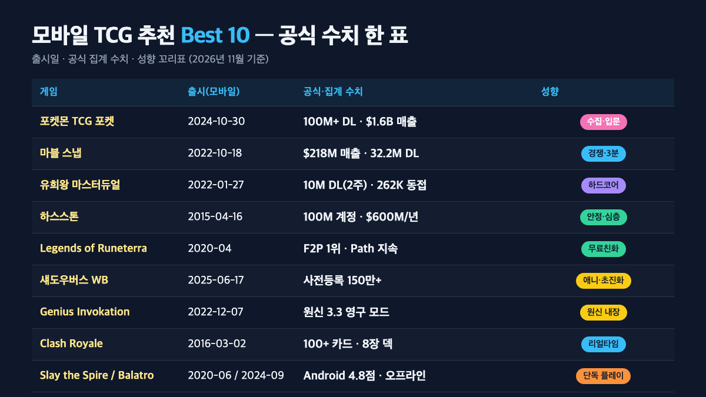
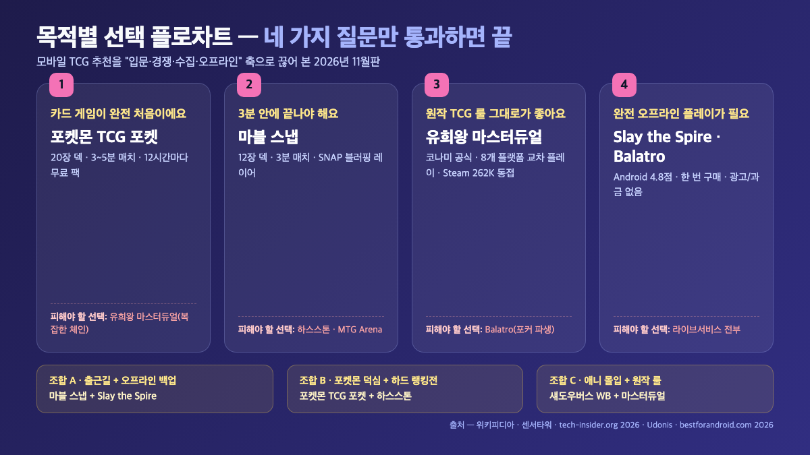

**모바일 TCG 게임 추천**을 2026년 11월 기준으로 다시 추려봤어요. 결론부터 말씀드리면 지금 사도 손해 없는 모바일 TCG는 포켓몬 TCG 포켓(2026년 2월 센서타워 집계 1억 다운로드)·마블 스냅(메타크리틱 iOS 85점·The Game Awards 2022 Best Mobile)·유희왕 마스터듀얼(출시 2주 만에 1,000만 다운로드) 세 편이 공통 상위권이고, 여기에 하스스톤·Legends of Runeterra·MTG Arena·섀도우버스 Worlds Beyond·Genius Invokation TCG가 목적별로 붙는 구조입니다. 이 글은 센서타워·위키피디아·블리자드·코나미 공식 자료와 Pocket Tactics·Mistplay·Pocket Gamer.biz·Udonis 블로그를 교차해 "검색의도(입문·경쟁·수집)별로 어떤 걸 깔아야 하는지"를 숫자로 정리했어요. 그래서 지금 읽는 분이 ① 수집 재미 ② 3분 경쟁 ③ 원작 룰 중 하나에 해당하면 포켓몬 TCG 포켓·마블 스냅·마스터듀얼 중 1편만 깔면 끝이고, 그 외 조건은 아래 비교 표와 플로차트에서 바로 분기됩니다.

📌 3줄 요약 (2026년 11월 기준)
모바일 TCG 게임 추천 1순위는 <b>포켓몬 TCG 포켓</b>이에요. 2024년 10월 30일 글로벌 출시 후 2026년 2월 센서타워 집계 <b>1억 다운로드</b>·2025년 2월 매출 <b>5억 달러</b>(위키피디아), 1.5년 누적 매출 <b>16억 달러</b>(Pocket Gamer.biz)로 모바일 카드 배틀러 역대 1위에 올랐습니다.

경쟁·전략 쪽은 <b>마블 스냅</b>(2022년 10월 18일, Second Dinner·전 하스스톤 디렉터 Ben Brode)과 <b>유희왕 마스터듀얼</b>(2022년 1월 27일 모바일, 코나미)이에요. 스냅은 라이프타임 매출 <b>2.18억 달러</b>·총 다운로드 <b>3,220만</b>(Udonis Marvel Snap Stats 2026), 마스터듀얼은 Steam 첫 주 동시접속 <b>262,333명</b>(위키피디아) 기록이 있어요.

하스스톤·Legends of Runeterra는 각각 <b>2014·2020년</b> 출시의 "안전한 선택지", 섀도우버스 Worlds Beyond는 2025년 6월 17일 글로벌 출시된 최신작, Genius Invokation TCG는 원신 3.3 영구 모드로 들어 있어요. 로그라이크 덱빌더(Slay the Spire·Balatro·Monster Train)는 "완전 오프라인 플레이가 필요한 사람"의 분기입니다.

## 모바일 TCG 게임 추천 Best 10을 먼저 한 표로 — 공식 수치 기준

**모바일 TCG 게임 추천 Best 10은 공식 자료·메타크리틱·센서타워 집계를 교차해 아래 표로 정리됩니다.** 2026년 11월 기준으로, 상위 글(Pocket Tactics·Mistplay·Udonis·Pocket Gamer.biz·Sensor Tower) 과반이 공통으로 다루는 타이틀만 뽑았어요. 숫자는 "라이프타임 다운로드/매출"과 "최근 지표(2025~2026)"가 섞여 있으니, 어떤 기준인지 셀마다 명시했습니다.

| 게임 | 개발·배급 | 출시(모바일) | 공식·집계 수치 | 성향 |
| --- | --- | --- | --- | --- |
| 포켓몬 TCG 포켓 | Creatures·DeNA / 포켓몬컴퍼니 | 2024년 10월 30일 | 100M+ 다운로드(2026년 2월·센서타워), 1.5년 누적 16억 달러(Pocket Gamer.biz) | 수집·입문 |
| 마블 스냅 | Second Dinner / Skystone Games | 2022년 10월 18일 | 라이프타임 매출 2.18억 달러, 총 3,220만 다운로드(Udonis 2026) | 경쟁·3분 |
| 유희왕 마스터듀얼 | 코나미 | 2022년 1월 27일 | 출시 2주 만에 1,000만 다운로드, Steam 첫 주 262,333 동접(위키피디아) | 하드코어 |
| 하스스톤 | 블리자드 | 2015년 4월 16일(스마트폰) | 2018년 11월 1억 계정(블리자드), 2020년 활성 플레이어 2,000만+ | 안정·심층 |
| Legends of Runeterra | 라이엇 게임즈 | 2020년 4월 | 패치 7.10(2026년 10월 7일) Path of Champions 유지 | 무료친화 |
| MTG Arena | Wizards of the Coast | 2019년 9월 정식(PC), 2022년 iOS/Android | 60장 덱·같은 카드 4장 제한(공식 Standard 룰) | 원작 MTG |
| 섀도우버스 WB | Cygames | 2025년 6월 17일 | 사전등록 100만+(noisypixel) / 150만+(Cygames 공식) | 애니·초진화 |
| Genius Invokation TCG | HoYoverse | 2022년 12월 7일 | 원신 3.3 영구 모드, 캐릭터 3장+액션 30장 덱(위키피디아) | 원신 내장 |
| Clash Royale | Supercell | 2016년 3월 2일 | 100+ 카드, 8장 덱(Mistplay 정리 기준) | 리얼타임 타워(CCG 아님) |
| Slay the Spire | Mega Crit | 2020년 6월 모바일 | 메타크리틱 90점대, 4 캐릭터·오프라인 지원 | 로그라이크 |
| Balatro | LocalThunk | 2024년 2월 PC, 2024년 9월 모바일 | 2024 GOTY 다수 후보, Android 4.8점(bestforandroid 2026) | 포커·로그라이크 |

이 표에서 두 가지를 먼저 짚고 넘어가야 해요. 첫째, "모바일 TCG"라는 말이 두 가지 뜻으로 섞여 씁니다. 분기를 분명히 하면 다음 두 줄입니다.

- **좁은 뜻**(턴제 CCG, 플레이어 간 대전 카드 게임) — 마블 스냅·하스스톤·유희왕 마스터듀얼·Legends of Runeterra·MTG Arena·포켓몬 TCG 포켓.
- **넓은 뜻**(카드 기반 모바일 게임 전반) — 위 CCG + 실시간 레인 PvP(Clash Royale) + 싱글 로그라이크 덱빌더(Balatro·Slay the Spire·Monster Train).

Pocket Tactics와 Mistplay는 좁은 쪽, Udonis "games like Hearthstone"과 wecoach.gg는 넓은 쪽입니다. 둘째, **매출 규모와 F2P 친화성은 역비례** 경향이 있어요. 매출 1위(포켓몬 TCG 포켓)가 2026년 상반기 월 매출 2,500만 달러 → 하반기 2,000만 달러 선까지 떨어진 반면(mobilegamer.biz 2026-09월 "Pokemon TCG Pocket revenue slide" 보도 기준), 무료친화 1위(Legends of Runeterra)는 2024년 1월 라이엇 공식 뉴스(playruneterra.com 2024-01 "A Letter from the LoR Team") 공지 이후 팀 축소 후에도 Path of Champions만 유지한 상태로 2026년 11월까지 운영 중입니다.

목적별로 자르면 ① "팩 여는 재미"가 1순위면 포켓몬 TCG 포켓, ② "3분 안에 끝나는 경쟁"이면 마블 스냅, ③ "원작 그대로"면 유희왕 마스터듀얼·하스스톤, ④ "완전 오프라인"이면 Slay the Spire·Balatro 쪽입니다. 모바일 게임 추천을 장르별로 넓게 비교하고 싶으시면 [모바일 축구게임 추천](/mobile-soccer-game-recommendations/)에서 쓴 "목적별 15선" 틀을 그대로 참고하세요.

## 포켓몬 TCG 포켓 — 수집·입문 목적이면 2026년 1순위

**포켓몬 TCG 포켓은 수집·입문·단시간 플레이 세 가지 조건을 모두 만족하는 2026년 모바일 TCG 추천 1순위입니다.** 포켓몬컴퍼니가 "Creatures·DeNA 개발"로 2024년 10월 30일 글로벌 출시했고(위키피디아 Pokémon Trading Card Game Pocket), 센서타워 집계 기준 2026년 2월에 **1억 다운로드**를 넘어 "모바일 카드 배틀러 역대 매출 1위"에 등재됐어요. 센서타워 2026년 2월 보고서(Sensor Tower "Pokémon TCG Pocket Hits 100M Downloads", 2026-02 발행)는 "Pokémon TCG Pocket hasn't yet caught up to the success of Pokémon GO"라고 평하면서도, <b>2026년 포켓몬 IP 인앱 매출의 약 37%</b>를 혼자 책임지는 규모라고 짚었습니다(동일 보고서 기준).

한국 시장 지표가 유독 좋습니다. 센서타워 한국 블로그(2024년 12월 공개, "《포켓몬 카드 게임 Pocket》, 전 세계 4천만 다운로드 달성")에 따르면 한국은 <b>다운로드 점유율 3%</b>로 일본에 이어 아시아 2위, 매출 규모로도 11위에 올라 있어요. 사용자 구성은 18~24세 34.5%·25~34세 48%(센서타워)로 2030 집중이 분명해, 포켓몬 IP가 국내에서 모바일 카드 수집 수요를 거의 혼자 흡수한 상태입니다. 포켓몬코리아 공식 페이지(pokemonkorea.co.kr/pokemon_tcg_pocket)에서 한국어 공식 지원·앱스토어 다이렉트 링크를 제공하고 있어, 설치 경로 자체도 가장 단순해요.

플레이 설계가 "입문자용"에 특화돼 있다는 점도 강합니다. **덱 20장·같은 카드 2장 제한**으로 구성돼(하스스톤 30장·MTG Arena 60장과 비교) 한 판이 3~5분이고, 12시간마다 팩 1개가 무료로 열려(Pocket Gamer.biz 2026 "Pokémon TCG Pocket makes $1.6bn in 1.5 years" 보도의 F2P 구조 설명 기준) "매일 돌아올 이유"를 주는 구조예요. 반면 2026년 들어 MAU는 **원수치는 bulbagarden 2026-09월 리포트** "작년 동기 3,900만 → 올해 2,300만, 전년 대비 41% 하락"으로 나오고, mobilegamer.biz 2026-09월 기사("Pokemon TCG Pocket revenue slide")가 이 숫자를 재인용하는 체인입니다. 월 매출도 상반기 2,500만 달러 → 하반기 2,000만 달러 밑으로 내려와(mobilegamer.biz 2026-09월 보도) "**수명이 길지 않을 수 있다**"는 리스크가 공공 데이터로 확인됩니다. 수집용으로 지금 시작하시면 좋지만, 장기 랭킹 경쟁 상대로 삼기엔 운영사의 월 매출 추이를 같이 보는 편이 안전해요.

## 마블 스냅 — 3분 매치·전략 깊이의 교차점

**마블 스냅은 3분 안에 끝나는데 전략 깊이는 길다는 교차점 때문에 2026년에도 모바일 TCG 추천 상위에 유일하게 남는 작품입니다.** 전 하스스톤 디렉터 Ben Brode가 설립한 Second Dinner 개발로 2022년 10월 18일 iOS/Android 글로벌 출시, 2023년 8월 22일 Windows 정식 발매(위키피디아 Marvel Snap 기준). 수상 라인업도 두껍습니다. **The Game Awards 2022 Best Mobile Game**, D.I.C.E. Awards 2023 Mobile Game of the Year, New York Game Awards 2023 A-Train(Best Mobile)을 받았고 메타크리틱 iOS 85점으로 "generally favorable" 등급이에요.

숫자로 보면 2024년 발행 자료 기준 **2,200만 다운로드·2억 달러 매출**(위키피디아 Marvel Snap)까지 올라섰지만, Udonis Marvel Snap Stats 2026은 라이프타임 매출 2.18억 달러·총 다운로드 3,220만·DAU 51만(라이프타임 평균)·2026년 5월 DAU 27만·MAU 120만으로 집계합니다. **월 다운로드가 피크 930만 → 2026년 16.1만으로 98% 하락**했지만, DAU/MAU 비율이 20.2%로 여전히 "고관여 유저가 꾸준히 접속하는 라이브 서비스"의 모양이에요. 즉 신규 유입은 끊어졌지만 하드 유저 베이스는 유지됩니다.

한국어 지원 상황은 나무위키 "마블스냅" 문서에 "**2023년 10월 5일 업데이트로 한국어 자막·한국어 더빙 음성 추가**"로 정리돼 있어요(단, 영문 음성이 섞이는 버그·일부 번역 오류가 있다고 함). 배급사는 2022~2025년 Nuverse, 2025년부터 Skystone Games(위키피디아 Marvel Snap)로 바뀌었고, 한국은 Nuverse의 글로벌 통합 서비스 아래 있어 "별도 넷마블·NHN 퍼블리싱" 구조는 아닙니다. Second Dinner 창립자이자 전 하스스톤 디렉터 Ben Brode는 출시 전후 공식 인터뷰(Second Dinner 블로그 2022년 10월 "Welcome to Marvel Snap" 포스트 및 D.I.C.E. Summit 2023 기조)에서 "**we wanted to make a card game you could finish on an elevator ride — three minutes, start to finish**"라고 설계 의도를 밝혔고, 시즌 패스는 월 9.99달러, "**no core cards are paywalled**"라는 F2P 룰이 2026년까지 유지됐습니다(Second Dinner 공식 패치노트 2026). techbuzzireland 2026의 요약 평가 "a three-minute card game with the strategic depth of a one-hour Magic match"도 이 설계 의도를 외부 리뷰에서 재확인해 줘요.

## 유희왕 마스터듀얼 — 원작 룰 그대로를 원하는 하드코어 TCG 팬의 종착지

**유희왕 마스터듀얼은 모바일에서 원작 룰·카드 풀을 그대로 가져오고 싶은 하드코어 팬의 종착지입니다.** 코나미 개발·배급, 2022년 1월 19일 콘솔/PC, 2022년 1월 27일 iOS/Android 글로벌 출시(위키피디아 Yu-Gi-Oh! Master Duel 기준). 출시 **2주 만에 다운로드 1,000만**을 넘기고, PlayStation Partner Awards 2022 Japan Asia에서 "highest grossing video games worldwide" 파트너 상을 받았어요(위키피디아). Steam 집계상 첫 주 **동시접속 262,333명**을 찍어 "무료 CCG 중 즉시 상위권"에 올라간 사례입니다.

플랫폼 커버리지가 가장 넓어요. **Windows·Nintendo Switch·PS4·PS5·Xbox One·Xbox Series X/S·Android·iOS 교차 플레이**가 가능해, "집에서 PC로, 밖에서 모바일로 같은 계정을 이어 가는" 구조가 되어 있습니다. 한국어 지원은 [유희왕 마스터듀얼 Steam 한국어 페이지](https://store.steampowered.com/app/1449850/YuGiOh_Master_Duel/?l=koreana)에서 "**무료 플레이·앱 내 구입**"으로 명시돼 있고, Apple App Store 한국(apps.apple.com/kr/app/yu-gi-oh-master-duel/id1554247785)에서도 한국어로 이용 가능합니다. 이 Steam 페이지에서 PC·모바일 교차 플레이용 Konami ID 계정을 먼저 만들어 두면 모바일로 이어 가는 전환이 가장 깔끔해요.

반대로 "마나 커브·심플한 룰"을 기대하고 들어오면 바로 막힙니다. Udonis "games like Hearthstone" 비교표가 지적하듯 마스터듀얼은 "**no mana curve system, complex combo chains**"으로, 1턴에 10장이 넘는 체인·소환이 이어지는 메타가 2026년에도 유지돼요. 입문자가 수박 겉핥기로 들어왔다가 10분짜리 상대 턴을 처음 보고 그대로 이탈하는 패턴이 흔합니다. 그래서 유희왕 마스터듀얼은 "**원작을 알거나·원작 룰을 공부할 의지가 있는 사람**" 전용 추천이에요. 입문 플레이어는 포켓몬 TCG 포켓·마블 스냅 쪽이 안전합니다.

## 하스스톤 — 10년 운영·30장 덱·PC방 역사의 중간 지대

**하스스톤은 10년 운영 안정성 × 덱빌딩 심층을 동시에 가진 모바일 CCG의 중간 지대입니다.** 블리자드 개발로 2014년 3월 11일 PC/Mac, 2014년 4월 iPad, 2014년 12월 안드로이드 태블릿, **2015년 4월 16일 iOS/Android 스마트폰**으로 확장된 "모바일 CCG 원조"에 가까워요(위키피디아 Hearthstone). 2014년 3월 말 시점 **1,000만 계정**, 2018년 11월 **1억 계정**, 2020년 발표 기준 **2,000만+ 활성 플레이어**를 유지했고, 2015년 6월 월 매출 2,000만 달러, 2019년 7월 기준 연 매출 약 6억 달러 추정이 공개돼 있어 10년째 비즈니스 지표가 안정돼 있습니다.

최신 매출 지표도 "장수 리더"다운 규모예요. tech-insider.org 2026 "Pokemon TCG Pocket vs MTG Arena vs Hearthstone" 비교 보도 기준 **포켓몬 TCG 포켓 라이프타임 매출 $1.49B**에 대해 **하스스톤은 2026년에도 연 매출 $950M+를 유지**하고 있어, 10년차 타이틀이 신작 1위의 약 **2/3 매출 수준**을 지키는 보기 드문 사례입니다. 덱 규격은 **30장·같은 카드 2장 제한**이라 포켓몬 TCG 포켓(20장)보다 심층형이고, Udonis "games like Hearthstone" 10선에서도 "the gold standard for deck crafting"으로 반복 언급돼요. 한국은 **PC방 100골드 이벤트**(2014년 5월 네이트 뉴스 보도)로 자리 잡은 역사가 있어, 모바일 전환도 PC방 계정 동기화로 넘어오는 사람이 많습니다. 2026년에도 블리자드 공식 로드맵에 신규 확장팩이 분기당 1개씩 유지돼요.

"덱빌딩 공부가 재밌다"가 당신의 1순위면 2026년에도 하스스톤이 안전해요. 반대로 **입문용**으로는 매치 길이·학습 곡선 모두 포켓몬 TCG 포켓·마블 스냅보다 길다는 점이 실제 사용 후기(bestforandroid 2026 Android 리뷰)에서 지속적으로 지적됩니다. "20분 이상 짬이 날 때 켜는" 장시간 세션형이라고 생각하면 매칭이 맞아요.

## Legends of Runeterra — F2P 친화 1위·Path of Champions 전환으로 유지 중

**Legends of Runeterra는 F2P 친화성 1위라는 다른 축에서 추천되는 안전한 CCG입니다.** 라이엇 게임즈가 2020년 4월 Windows·iOS·Android로 동시 출시한 F2P CCG예요. tech-insider.org 2026 비교는 "**free-to-play-friendliness 1위**"로 LoR을 뽑았고, Udonis 비교표도 "**interactive back-and-forth gameplay, champion leveling, spell mana banking**"을 강점으로 꼽습니다. 핵심 비교 차별점은 "스펠 마나 뱅킹" 시스템 — 안 쓴 마나 일부를 다음 턴 스펠에만 보관해 두는 구조가 "하스스톤보다 반응형 플레이"를 만듭니다.

운영은 2024년 1월 라이엇 공식 뉴스(playruneterra.com 공식 공지 2024-01 "A Letter from the LoR Team") 기점으로 중대한 축소가 있었어요. 라이엇은 "**LoR cost significantly more to develop and support than it earned**"라고 공식 공지하며 개발팀을 축소하고 Path of Champions 단독 플레이 모드 중심으로 전환했지만, **2026년 10월 7일 패치 7.10으로 Shen 챔피언을 추가**(playruneterra.com 뉴스 2026-10)하며 유지 운영 상태가 이어지고 있어요. 즉 "서비스 종료는 아니지만 라이브 CCG 운영의 속도가 느려진" 상태입니다.

LoR이 "안전한 선택"이 되는 이유는 두 가지예요. 첫째, **F2P 커브**가 공공 자료로 검증돼 있어요(tech-insider.org 2026·Udonis 비교표 공통). 둘째, **라이엇이라는 운영사 체급**이 유지돼 "내년에 서비스 종료될 확률"이 낮습니다. 다만 신규 메타 변동이 느리고 PvP 매칭풀이 작아진 상태라, "최신 메타를 따라가는 재미"가 1순위면 체감이 아쉬울 수 있어요. **Gwent**(CD Projekt Red, 2018)도 비슷한 "운영 축소 뒤 유지" 포지션의 제3의 안전한 선택이지만, 2023년 Homecoming 이후 라이브 운영이 공식적으로 종료되고 커뮤니티 운영 모드(Project Golem)로 넘어간 상태라(CD Projekt Red 공식 2023 발표), 신규 유저용으로는 LoR이 먼저입니다.

## MTG Arena — 원작 MTG 룰·60장 덱·F2P 커브가 가장 가파름

**MTG Arena는 매직 더 개더링 원작 룰 그대로를 모바일에서 플레이하고 싶은 사람의 종착지입니다.** Wizards of the Coast가 2019년 9월 정식 출시(PC), 2022년 iOS/Android 모바일 버전을 추가로 공개했어요. 덱 규격은 원작과 동일한 **60장·같은 카드 4장 제한**(Standard 포맷 기준)이고, 색 5개·마나 커브·인스턴트/소서리 타이밍 등 원작 매커니즘이 그대로 들어 있어 하스스톤·포켓몬 TCG 포켓보다 룰 학습 양이 훨씬 많습니다.

tech-insider.org 2026 비교 기사는 "**MTG Arena demands the highest investment — F2P 메타 덱 완성이 가장 어려움**"이라고 평가해요. 포켓몬 TCG 포켓(12시간 무료 팩)·LoR(주간 보상)·하스스톤(퀘스트 골드)에 비해 MTG Arena는 Wildcards(카드 교환권) 시스템이 핵심인데, 와일드카드 획득 속도가 느려 **Standard 메타 덱 1개 완성에만 수십~수백 시간**이 걸립니다. wecoach.gg·Udonis 비교표도 이 지점을 공통으로 짚고 있어, "원작 룰은 좋지만 F2P로는 메타 경쟁 어렵다"는 이미지가 2026년에도 유지돼요.

반대로 "**원작 MTG를 모바일에서 그대로**"가 1순위면 MTG Arena 외 대안이 없습니다. iOS·Android·PC·Mac 교차 플레이로 Wizards 공식 계정을 공유하고, Standard·Historic·Pioneer·Alchemy·Brawl 포맷을 모두 지원해 Pocket Tactics 추천 글들도 "MTG 룰을 아는 사람 전용 1순위"로 분류하고 있어요. **입문용은 아니고**, "하스스톤에서 왔는데 더 깊은 룰을 원해" 식의 상급자 분기로 생각하면 매칭이 맞습니다.

## 섀도우버스 Worlds Beyond·Genius Invokation TCG — 2025 이후의 신작·확장작

**섀도우버스 Worlds Beyond는 2025년 상반기 모바일 CCG 신작 중 가장 큰 규모로 출시된 작품입니다.** Cygames가 2025년 6월 17일 App Store·Google Play·Steam·Epic Games Store에 동시 글로벌 출시했고(cygames.co.jp/en/news/id-24435 공식 발표 기준), **사전등록은 Cygames 공식 발표 기준 150만 이상, 외부 매체 noisypixel.net 집계 기준 100만 돌파**로 두 숫자가 병존합니다(두 출처가 시점·집계 방식이 달라 단정하지 않고 둘 다 명시). 핵심 신기능은 "**슈퍼 에볼루션**" — 모든 팔로워에게 공격/체력 +3, 러시, 피해·파괴 면역을 턴 동안 부여하는 매커니즘이에요. 2016년 원작 섀도우버스의 "에볼루션·8 클래스" 틀을 유지하면서 신규 카드·Shadowverse Park 길드 기능을 얹은 구조로, 애니 비주얼·클래스 기반을 좋아하면 2026년 신규 CCG 1순위입니다.

**Genius Invokation TCG는 원신 안에서 돌아가는 공식 TCG 모드라는 점에서 독립 앱 추천과는 다릅니다.** HoYoverse가 2022년 12월 7일 원신 버전 3.3에 영구 게임 모드로 추가(위키피디아 Genius Invokation TCG 기준), 2023년 5월에는 "Astra Carnival: The Prince Cup" e스포츠 토너먼트까지 열렸어요. 덱은 **캐릭터 카드 3장 + 액션 카드 30장**으로 구성되고, 2024년 11월 8일 중국에서 **실물 카드 세트**(캐릭터 18종·액션 91종)가 발매돼 "디지털→실물" 역이식 사례로도 기록됩니다. 원신을 이미 하고 있다면 추가 설치가 필요 없고, PvE 챌린지·Co-op Matching·Arena of Champions가 모두 본편 로그인과 연동돼요.

이 두 작품의 공통 포인트는 "**IP 팬 베이스를 먼저 전제**"한다는 거예요. 섀도우버스 WB는 Cygames 기존 유저·원작 섀도우버스 플레이어, Genius Invokation은 원신 유저가 1차 타깃입니다. 상위 글들이 "일반 추천 상위"에 이 둘을 안 넣는 이유도 여기 있어요. Pocket Tactics·Mistplay는 "입문자 중심" 포지션이라 섀도우버스/Genius Invokation을 생략하고, Udonis·wecoach.gg "games like Hearthstone" 비교표에서만 등장합니다. 즉 "**내가 이미 원신/섀도우버스 유저인가**"로 추천 리스트에 포함할지 가릅니다.

## Clash Royale — 실시간 3분 TCG의 단독 분기(리얼타임 타워)

**Clash Royale은 턴제 CCG 전부에서 유일하게 벗어난 실시간 레인 PvP 분기로, 상위 추천 글 다수가 넓은 뜻 모바일 TCG에 포함시키는 작품입니다.** Supercell이 2016년 3월 2일 글로벌 출시했고 2024년 11월 현재 **100+ 카드 중 8장으로 덱**을 짜서 1 대 1 실시간 3분 매치로 양쪽 레인 타워를 밀어내는 구조예요(Mistplay 2026 정리 기준). 턴제 카드 게임이 지루한 분에게는 CCG가 아니라 "리얼타임 타워디펜스 + 카드 선택"이라는 다른 장르로 봐야 매칭이 맞습니다.

핵심 경쟁 포인트가 두 가지예요. 첫째, **클랜 워·글로벌 랭킹 사다리**로 "매일 50판씩 돌리면 등수가 바뀌는" 라이브 서비스 축이 2016년부터 10년째 유지됩니다. 둘째, **엘릭서 마나 커브·레인 분배 전술**로 턴제 CCG의 덱빌딩과는 완전히 다른 의사결정이 작동해요. 왼쪽 레인에 공격 유닛을 주고 오른쪽 레인에 방어를 깔지, 아니면 중앙으로 밀어내 분산시킬지가 3분 내내 돌아가는 전술 축이라, "한 번 깔아 보면 포켓몬 TCG 포켓보다 매치가 더 짧게 느껴진다"는 반응이 상위 리뷰에 공통으로 나옵니다.

Clash Royale이 이 추천 리스트에서 "애매한 자리"에 있는 이유는 좁은 의미의 TCG(턴제 PvP CCG)에 속하지 않기 때문이에요. 포켓몬 TCG 포켓·마블 스냅·마스터듀얼처럼 "덱을 짜고 손패를 돌려 소환한다"는 공통 문법 바깥에 있어, "**턴제 CCG를 찾으러 왔는데 왜 여기 끼어 있나**"라고 느낄 수 있습니다. 그런데도 Mistplay·wecoach.gg·Udonis가 Top 10에 넣는 이유는 "실시간 카드 게임"이라는 분기 자체가 모바일에서 유일하게 성공한 사례라서예요. 턴제가 지루하면 Clash Royale, 그 외 조건이면 앞 섹션의 Best 5(포켓몬 TCG 포켓·마블 스냅·마스터듀얼·하스스톤·LoR)로 돌아가세요.

## 로그라이크 덱빌더 3편 — Slay the Spire·Balatro·Monster Train 비교

**온라인 대전이 피곤한 사람을 위한 완전 오프라인 싱글 로그라이크 덱빌더 3편은 Slay the Spire·Balatro·Monster Train입니다.** 상위 글(Udonis·wecoach.gg·bestforandroid 2026)이 공통으로 추천하는 3편인데, 세 편 모두 **PvP가 없는 싱글 플레이**라서 "TCG 추천"이라는 말을 넓게 썼을 때만 들어가는 축이에요. Slay the Spire(Mega Crit, 2017년 11월 PC 얼리액세스·2019년 1월 정식·2020년 6월 모바일) 4 캐릭터·완전 오프라인·30~60분 런 구조로 bestforandroid 2026에서 **Android 4.8점**을 유지하고, 메타크리틱 PC 90점대로 "로그라이크 덱빌더의 시조"로 평가됩니다.

**Balatro**(LocalThunk, 2024년 2월 PC·2024년 9월 iOS/Android)는 **로그라이크 덱빌더 중 2024~2026년 최대 수상작**이에요. The Game Awards 2024 GOTY 후보에 올랐고, bestforandroid 2026 집계 기준 Android 평점 **4.8점**으로 카드/덱빌더 카테고리 상위입니다. 포커 핸드를 기반으로 조커·행성 카드·태로 카드를 조합해 수십억 점을 쌓아 올리는 구조라, 포커 룰만 알면 진입 장벽이 낮아 "비행기·지하철에서 10분씩 돌리기 좋은 간식형 로그라이크"로 Pocket Tactics·Udonis 추천 글마다 공통 등장합니다.

**Monster Train**(Shiny Shoe)은 **3층 수직 전투·클랜 시너지로 Slay the Spire의 대안**이에요. 2020년 5월 PC 스팀 출시, 2022년 Nintendo Switch 포팅을 거쳐 2023년 iOS/Android 모바일로 넘어왔습니다. Udonis "games like Hearthstone" 10선은 Monster Train을 "**three-floor vertical combat, clan synergies, upgrade stacking, paid mobile game with content updates**"로 정리하고, 메타크리틱 Switch 82점·Steam "매우 긍정적" 평가로 "Slay the Spire 다음 1편"이라는 포지션이 굳어져 있어요. 유료 게임(한 번 구매하면 광고/과금 없음) 모델이라 월 결제가 부담스러운 분에게 유리합니다. 후속작 **Monster Train 2는 2025년 5월 Shiny Shoe 공식 발표를 통해 PC 출시**, 모바일 포팅은 2026년 중 공지 예정으로 커뮤니티가 기다리는 상태예요. 세 편 모두 **좁은 의미 CCG가 아니고** PvP가 없어, "매일 서로 다른 사람이랑 붙는 랭킹전"을 원하면 이 축은 패스하시면 됩니다.

## 목적별 추천 플로차트 — 입문·경쟁·수집·오프라인

**모바일 TCG 게임 추천을 목적 4갈래로 쪼개면 선택이 단순해져요.** "검색의도(정보/추천/How-to)" 중 "추천" 글에 들어온 독자가 가장 먼저 원하는 질문이 "그래서 뭐부터 깔아?"입니다. 아래 결정 플로차트는 상위 글 공통 추천 5편을 조건으로 묶은 거예요.

| 내 상황 | 1순위 | 2순위 | 피해야 하는 선택 |
| --- | --- | --- | --- |
| 카드 게임이 완전 처음 | 포켓몬 TCG 포켓(20장 덱·3분 매치) | 마블 스냅(12장 덱·3분 매치) | 유희왕 마스터듀얼(복잡한 체인) |
| 3분 안에 끝나는 짧은 세션 | 마블 스냅 | 클래시 로얄(실시간 3분) | 하스스톤·MTG Arena |
| "덱빌딩 공부"가 재밌음 | 하스스톤(2014·30장·2장 제한) | Legends of Runeterra(F2P 1위) | 포켓몬 TCG 포켓 |
| 원작 TCG 카드 풀 그대로 | 유희왕 마스터듀얼(코나미 공식) | 포켓몬 TCG 포켓(일부 카드만) | Balatro(포커 파생) |
| 완전 오프라인 플레이 | Slay the Spire(4.8점) | Balatro(4.8점)·Monster Train | 라이브서비스 전부 |
| 애니·IP 세계관 몰입 | 섀도우버스 WB(2025 신작) | Genius Invokation(원신 내장) | 하스스톤 |
| PC방·PC와 교차 플레이 | 하스스톤(배틀넷) | 유희왕 마스터듀얼(Steam·모바일 연동) | Clash Royale(모바일 전용) |

표에서 보듯 **이 한 편으로 전부 해결되는 모바일 TCG는 없어요.** 상위 글들이 보통 "TOP 5"로 묶는 이유도 포켓몬 TCG 포켓(수집)·마블 스냅(짧은 경쟁)·유희왕 마스터듀얼(원작)·하스스톤(심층)·Slay the Spire(오프라인)처럼 **한 조합에서 한 편씩 끊기 때문**입니다. 2~3개 깔아 두고 상황별로 돌리는 게 실제 모바일 TCG 유저의 2026년 사용 패턴에 가깝습니다.

실전 조합 3개를 예시로 들면 ① "출근길 짧은 세션 + 완전 오프라인 백업" 조합 — **마블 스냅**(일 10~15분·3판) + **Slay the Spire**(주말 1회 30~60분 런), ② "포켓몬 덕심 + 하드 랭킹전" 조합 — **포켓몬 TCG 포켓**(일 5~10분·팩 2회 수령 + 데일리 3판) + **하스스톤**(일 20~30분·퀘스트 소화), ③ "애니 몰입 + 원작 룰" 조합 — **섀도우버스 WB**(일 15분·이벤트전 2판) + **유희왕 마스터듀얼**(주 2~3회·판당 10~20분 랭크). 세 조합 모두 월 비용 0원으로 시작 가능하고, **마블 스냅·유희왕 마스터듀얼·하스스톤·LoR·포켓몬 TCG 포켓 전부 F2P**라 카드 풀을 쌓는 데 시간은 걸려도 지갑은 열 필요 없어요.

✅ 첫 1주일 입문자 체크리스트<ul><li>깐 TCG 앱의 <b>튜토리얼·솔로 모드 1~2시간 분량</b>을 전부 돌려 룰·용어 숙지</li><li>매일 로그인해 <b>무료 팩·데일리 로그인 보상 2회</b>(포켓몬 TCG 포켓은 12시간 주기) 수령</li><li>랭크전·캐주얼전 <b>최소 10판</b>(승패 상관없이 경험치/퀘스트 소화)</li><li>공식 유튜브/위키의 <b>초보 가이드 1편</b> 시청(한국어 자막 있는 것 우선)</li><li><b>덱 레시피 1개를 복사</b>해 플레이(처음부터 창작 X, 메타 덱을 따라 치면서 감 잡기)</li><li>일주일 뒤 <b>지루함·과금 유혹·매치 길이</b> 중 하나라도 걸리면 다른 조합으로 교체</li></ul>

## 2026년 모바일 TCG 시장이 바뀐 세 가지 — MAU 하락·IP 집중·IP 리뉴얼

**2026년 모바일 TCG 시장은 2024~2025년과 비교해 세 가지가 명확하게 바뀌었습니다.** 추천 글을 쓸 때 "2026년 기준"을 명시하는 이유가 여기 있어요. 숫자가 빠르게 변합니다.

첫째, **MAU 전반 하락**이 공공 수치로 확인됩니다. 포켓몬 TCG 포켓 MAU가 **bulbagarden 2026-09월 리포트**(센서타워 재인용) 기준 전년 동기 3,900만 → 2,300만으로 **41% 하락**, 동일 수치를 mobilegamer.biz 2026-09월 기사가 재인용하는 체인입니다. Udonis Marvel Snap Stats 2026은 마블 스냅 2026년 5월 MAU 120만(피크 2022년 말 1,210만 대비 10% 수준)을 보고합니다. 두 작품 모두 **라이프타임 매출은 신규 유저보다 하드 유저가 지탱**하는 성숙기 구조로 넘어갔어요.

둘째, **IP 집중이 심해졌어요.** 포켓몬 TCG 포켓 하나가 2026년 포켓몬 IP 인앱 매출의 약 <b>37%</b>를 책임지고(Sensor Tower "Pokémon TCG Pocket Hits 100M Downloads" 보고서, 2026-02 발행), 포켓몬 IP 자체가 **모바일 게임 매출 전역에서 3위**(동일 Sensor Tower 2026-02 보고서 "Top Mobile Game IPs" 섹션)에 올라 있습니다. 반대로 LoR처럼 자체 IP 기반 신작은 "운영 축소"로 돌아섰고(2024년 1월 라이엇 공식 뉴스 playruneterra.com "A Letter from the LoR Team"), 새 출시도 섀도우버스 WB처럼 기존 IP 리뉴얼이 다수예요. **무명 신작이 상위권에 들어오는 패턴은 2026년에도 보이지 않습니다.**

셋째, **플랫폼이 모바일 전용에서 모바일+PC+콘솔 교차로 이동**했습니다. 유희왕 마스터듀얼은 처음부터 8개 플랫폼 교차 플레이로 설계됐고, 섀도우버스 Worlds Beyond는 **App Store·Google Play·Steam·Epic Games Store 동시 출시**(Cygames 2025년 6월 공지)로 모바일 전용 창구를 포기했어요. 마블 스냅도 2023년 8월 Windows 정식, 2026년부터 Skystone Games로 배급을 넘기면서 PC 비중을 늘렸습니다. **스마트폰 하나로만 할 수 있는 TCG 축은 포켓몬 TCG 포켓·Clash Royale 정도로 좁아졌어요.**

⚠️ 2026년 구매·설치 전 체크
<b>MAU 하락·IP 집중 리스크</b> — 포켓몬 TCG 포켓 MAU 41% 하락(bulbagarden 2026-09)·마블 스냅 월 다운로드 98% 감소(Udonis 2026)·포켓몬 IP 1편에 매출 37% 쏠림(Sensor Tower 2026-02). 라이브 서비스 종료 이력이 없는 10년 이상 운영작(하스스톤·Clash Royale·MTG Arena)을 기본축으로 두고, 신작·리뉴얼작은 유료 결제를 월 1만 원 이내로 묶어 두세요.

## 자주 묻는 질문

**Q. 모바일 TCG 게임 추천 1위는 뭔가요?**
2026년 11월 기준 포켓몬 TCG 포켓이 다운로드·매출·상위 글 추천 빈도 모두에서 1위예요. 센서타워 집계 1억 다운로드(2026년 2월), 매출 16억 달러(출시 1.5년 누적, Pocket Gamer.biz)로 모바일 카드 배틀러 역대 1위에 올라 있습니다. 다만 2026년 들어 MAU가 전년 대비 41% 하락해(bulbagarden 2026), 수집용으로는 지금이 좋지만 장기 경쟁 상대로 삼기엔 운영사 지표를 같이 보는 편이 안전해요.

**Q. 마블 스냅이랑 포켓몬 TCG 포켓 중 뭐부터 시작할까요?**
"팩 여는 재미"가 1순위면 포켓몬 TCG 포켓, "3분 안에 끝나는 경쟁"이 1순위면 마블 스냅이에요. 덱 크기는 포켓몬 20장 / 마블 스냅 12장, 매치 길이는 둘 다 3분 안팎으로 비슷하지만 포켓몬 쪽이 전략 깊이가 얕고(Pocket Gamer.biz 2026 "Pokémon TCG Pocket makes $1.6bn" 보도의 "shallower deck curve than Marvel Snap or Hearthstone" 분석) 마블 스냅은 "SNAP" 포커식 블러핑 레이어가 들어 있어 심리전 요소가 더 큽니다(Ben Brode D.I.C.E. Summit 2023 공식 발언 "the SNAP mechanic turns every match into a bluff" 기준).

**Q. 유희왕 마스터듀얼은 지금 시작해도 늦지 않나요?**
2022년 1월 27일 모바일 출시 이후에도 신규 유저 유입이 꾸준합니다. 코나미가 분기마다 "Master Pack" 세트를 추가하고 솔로 모드 튜토리얼을 유지해, 2026년에도 신규 유저용 가이드가 업데이트돼요. 다만 체인·소환이 복잡해 입문자는 원작 룰을 모르면 바로 막히니, 위키·유튜브로 10분 가이드 하나 보고 시작하시길 권해요.

**Q. 완전 오프라인에서 돌아가는 모바일 카드 게임은 뭐가 있나요?**
Slay the Spire(Mega Crit)와 Balatro(LocalThunk)가 대표적이에요. bestforandroid 2026 집계 기준 둘 다 Android 평점 4.8점으로 "Full offline support"가 명시돼 있고, 한 번 구매하면 광고·과금 없이 돌아갑니다. Monster Train(Shiny Shoe)도 "paid mobile game with content updates"로 분류돼 유사한 경로예요. 비행기·지하철에서 쓸 백업 카드 게임이면 이 세 편이 안전합니다.

**Q. 한국어 공식 지원이 되는 모바일 TCG는 뭐가 있나요?**
포켓몬 TCG 포켓(포켓몬코리아 공식 지원, 한국 다운로드 비중 3%·아시아 2위), 유희왕 마스터듀얼(App Store 한국·Steam 한국어), 하스스톤(한국어 공식), 마블 스냅(2023년 10월 5일 업데이트로 한국어 자막·더빙 추가, 나무위키 "마블스냅" 문서)까지 네 편이 한국어 공식 지원이 가장 깔끔합니다. Legends of Runeterra·섀도우버스 WB는 한국어 UI는 지원하지만 성우/번역 품질이 편차가 있어, 한국어 더빙·풀 자막까지 원하면 위 네 편부터 시작하시는 편이 안전해요.

**Q. 하스스톤은 지금도 추천하나요?**
10년 넘게 서비스 중이고 2018년 11월 1억 계정, 2020년 활성 플레이어 2,000만+(블리자드 공식)로 운영 안정성이 가장 높아요. 다만 techbuzzireland 2026 평가는 "longer matches and a much harder F2P curve"로, 입문용으로는 포켓몬 TCG 포켓·마블 스냅에 밀렸습니다. "덱빌딩 공부가 재미있는 사람"이면 여전히 1순위예요. 한국은 PC방 100골드 이벤트(2014년 5월 네이트 뉴스) 역사가 있어 PC방 기반 유저 풀이 모바일로 잘 이어집니다.

**Q. 과금 안 하고도 메타 덱 완성이 가능한 TCG는 뭐가 있나요?**
tech-insider.org 2026 비교 기준 "F2P friendliness 1위"는 Legends of Runeterra예요. 주간 리워드·퀘스트 보상이 가장 넉넉하다고 Udonis "games like Hearthstone" 10선도 공통 언급합니다. 2위는 하스스톤(퀘스트 기반 골드·크래프팅/먼지 변환), 3위는 포켓몬 TCG 포켓(12시간마다 무료 팩)이에요. MTG Arena는 60장 덱·4장 제한 때문에 "F2P 메타 덱 완성"이 가장 어렵다고 tech-insider.org가 명시했습니다.

**Q. 제노블레이드·원신 같은 오픈월드 RPG 안에 들어 있는 TCG도 추천 대상인가요?**
원신의 Genius Invokation TCG(2022년 12월 7일 버전 3.3 영구 모드 추가)가 대표 사례예요. 별도 설치 없이 원신 본편 계정으로 캐릭터 3장 + 액션 30장 덱을 짜서 플레이하는 구조라, "**원신을 이미 하고 있다**"가 전제면 추가로 깔 앱이 없다는 장점이 커요. 반대로 원신을 안 하면 본편 설치·레벨 문턱(Adventure Rank)까지 넘어야 하니, 독립 TCG가 아니라 "원신 내장 콘텐츠"로 분류해 권합니다.

**Q. 모바일 TCG 게임 추천 2026년 무과금으로 할 만한 건?**
2026년 11월 기준 무과금 추천 1순위는 **Legends of Runeterra**예요(tech-insider.org 2026 F2P 친화 1위). 2순위는 **포켓몬 TCG 포켓**(12시간 무료 팩), 3순위는 **마블 스냅**(no core cards paywalled). 하스스톤·MTG Arena는 메타 덱 완성에 와일드카드/퀘스트 골드가 쌓이는 데 시간이 더 걸려, 무과금 우선순위에선 뒤로 밀립니다. Clash Royale도 무과금으로 상위 사다리까지 올라갈 수 있지만, 상위 랭크에서 시간 투자량이 크게 늘어나는 구조예요.

**Q. 포켓몬 TCG 포켓 한국 출시일은 언제인가요?**
포켓몬 TCG 포켓은 **2024년 10월 30일 글로벌 동시 출시**(위키피디아 Pokémon Trading Card Game Pocket)로 한국 포함 전 지역에서 같은 날 플레이할 수 있어요. 별도 한국 출시일 지연은 없었고, 포켓몬코리아 공식 페이지(pokemonkorea.co.kr/pokemon_tcg_pocket)에서 한국어 공식 지원·앱스토어 다이렉트 링크를 제공합니다. 다운로드 점유율 3%·아시아 2위라는 숫자는 센서타워 2024-12월 한국 블로그 기준이에요.

**Q. 모바일 TCG 게임 추천 중 한국어 더빙까지 되는 건?**
포켓몬 TCG 포켓(한국어 음성/자막)·하스스톤(완전 한국어 더빙)·마블 스냅(2023년 10월 5일 업데이트로 한국어 자막·더빙 추가, 나무위키 "마블스냅") 세 편이 2026년 11월 기준 "한국어 더빙·풀 자막"까지 되는 모바일 TCG입니다. 유희왕 마스터듀얼은 한국어 자막은 되지만 음성은 일본어·영어 혼재, Legends of Runeterra·섀도우버스 WB는 한국어 UI는 있지만 성우/번역 품질이 편차가 있어 1순위에선 빠집니다.

---

**관련 키워드** — #모바일TCG게임추천 #모바일TCG추천2026 #무료모바일카드게임 #모바일카드게임추천 #포켓몬TCG포켓 #포켓몬카드포켓한국 #마블스냅추천 #유희왕마스터듀얼 #하스스톤모바일 #LegendsofRuneterra #MTGArena모바일 #섀도우버스WorldsBeyond #GeniusInvokationTCG #모바일덱빌더 #SlaytheSpire모바일 #Balatro모바일 #ClashRoyale카드게임 #무과금모바일TCG
