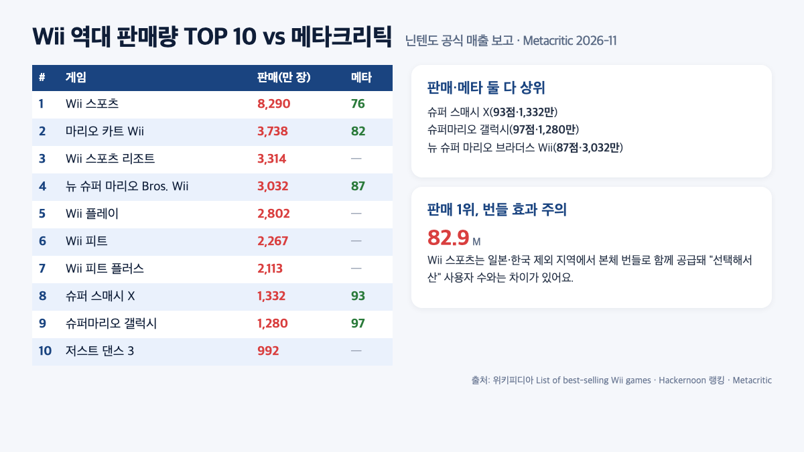
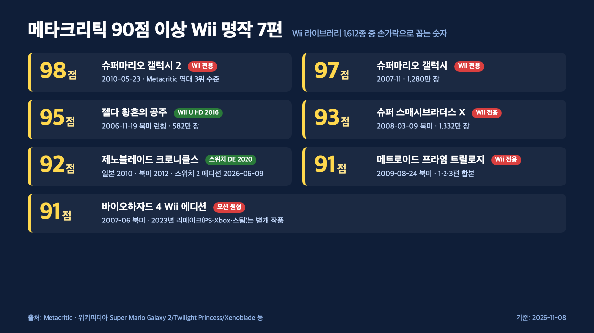
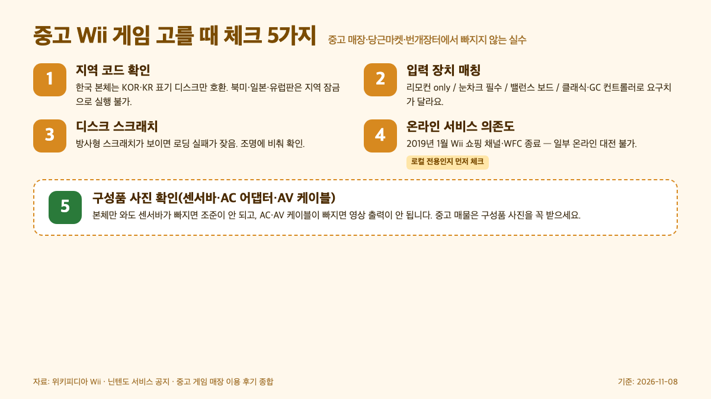

**닌텐도 Wii 게임 추천**을 찾으신다면 가장 먼저 봐야 할 숫자가 메타크리틱 98점짜리 슈퍼마리오 갤럭시 2예요. 결론부터 말씀드리면 Wii 라이브러리 1,612종(위키피디아 List of Wii games 기준) 중에서 2026년에도 "지금 사도 손해 없는" 게임은 메타크리틱 90점 이상·누적 판매량 상위·장르별 대표작이 겹치는 10~12편으로 좁혀집니다. 이 글은 2026년 11월 기준으로 닌텐도 공식 매출 자료, 메타크리틱 집계, 위키피디아 역대 판매 데이터를 교차해 장르·플레이 인원·중고 구입 방법까지 정리했어요.

📌 3줄 요약 (2026년 11월 기준)
닌텐도 Wii 게임 추천 1순위는 <b>메타크리틱 98점</b> 슈퍼마리오 갤럭시 2예요(메타크리틱 전체 역대 3위). 그 뒤로 젤다 황혼의 공주 <b>95점</b>·대난투 브라더스 X <b>93점</b>·제노블레이드 <b>92점</b>·바이오하자드 4 <b>91점</b>이 90점대에 올라 있어요.

판매량으로 보면 Wii 스포츠 <b>8,290만 장</b>, 마리오 카트 Wii <b>3,738만 장</b>, Wii 스포츠 리조트 <b>3,314만 장</b>(닌텐도 공식 매출 보고 기준) 세 편이 사실상 Wii의 얼굴입니다.

지금 사려면 ① 중고 Wii + 디스크, ② Wii U에서 Wii 디스크 그대로 호환, ③ 스위치·스위치 2 HD 리마스터(황혼의 공주 HD·제노블레이드 DE·동킹콩 리턴즈 HD) 세 갈래로 나뉘고, Wii 쇼핑 채널·버추얼 콘솔은 2019년 1월에 서비스 종료됐어요.

## 닌텐도 Wii 게임 추천 TOP 3를 먼저 — 메타크리틱·판매량이 함께 높은 작품

**닌텐도 Wii 게임 추천에서 가장 안전한 3편은 슈퍼마리오 갤럭시 2·마리오 카트 Wii·Wii 스포츠 리조트입니다.** 이 세 편은 2026년 11월 기준 메타크리틱 점수와 누적 판매량이 모두 상위권에 들어가, "산 뒤에 실망할 확률"이 가장 낮아요. 메타크리틱 집계에 따르면 슈퍼마리오 갤럭시 2는 2010년 5월 23일(북미) 발매 이후 메타스코어 98점으로 Wii 플랫폼 최고점이자 메타크리틱 전체 역대 3위 수준입니다(NintendoLife 2026년 7월 보도는 "Super Mario Galaxy 2 Metascore raised from 97 to 98"로 전했어요).

마리오 카트 Wii는 2008년 4월 발매, 메타스코어 82점, 2021년 3월 기준 3,738만 장(닌텐도 공식 매출 보고)이 팔려 역대 마리오 카트 시리즈 2위입니다. Wii 스포츠 리조트는 2009년 발매, 누적 3,314만 장이에요. 세 편 모두 Wii 리모컨 기본 조작이 뼈대라, 리모컨 1~2개만 있으면 게임 자체는 그대로 즐길 수 있다는 점이 "첫 Wii 라이브러리"에 가장 유리합니다.

이 TOP 3를 기준으로 두면 다음 섹션들의 "장르별 추천"이나 "메타크리틱 90점 이상" 목록에서 어떤 걸 더할지 판단이 쉬워져요. 세 편이 모두 액션·레이싱·스포츠 계열이라, 느긋한 모험을 원하시면 바로 다음 소제목의 젤다·제노블레이드 쪽으로, 짧게 몸을 움직이고 싶으시면 판매량 TOP 10 중 Wii 피트·저스트 댄스 쪽으로 분기하시면 됩니다.

## Wii 역대 판매량 TOP 10으로 보는 "안전한 선택"

**Wii 역대 판매량 TOP 10은 닌텐도 공식 매출 보고 기준으로 아래와 같이 집계됩니다**(위키피디아 List of best-selling Wii video games, Hackernoon "10 Best Nintendo Wii Games of All Time Ranked by Sales" 교차).

| 순위 | 게임 | 누적 판매(장) | 발매 | 메타스코어 |
| --- | --- | --- | --- | --- |
| 1 | Wii 스포츠 | 8,290만 | 2006 | 76점 |
| 2 | 마리오 카트 Wii | 3,738만 | 2008 | 82점 |
| 3 | Wii 스포츠 리조트 | 3,314만 | 2009 | — |
| 4 | 뉴 슈퍼 마리오 브라더스 Wii | 3,032만 | 2009 | 87점 |
| 5 | Wii 플레이 | 2,802만 | 2006 | — |
| 6 | Wii 피트 | 2,267만 | 2007 | — |
| 7 | Wii 피트 플러스 | 2,113만 | 2009 | — |
| 8 | 슈퍼 스매시브라더스 X | 1,332만 | 2008 | 93점 |
| 9 | 슈퍼마리오 갤럭시 | 1,280만 | 2007 | 97점 |
| 10 | 저스트 댄스 3 | 992만 | 2011 | — |

여기서 눈여겨볼 지점이 두 가지예요. 첫째, Wii 스포츠는 일본·한국을 제외한 대부분 지역에서 본체 번들로 함께 들어 있던 타이틀입니다(위키피디아 Wii Sports). 그래서 "본체를 샀으니 저절로 생긴" 사용자가 많고, 판매량 1위라는 숫자를 그대로 "최고의 게임"으로 읽으면 곤란해요. 둘째, 판매량 상위 10편 중 메타크리틱 90점을 넘는 작품은 대난투 브라더스 X와 슈퍼마리오 갤럭시 두 편뿐입니다(메타크리틱 집계 기준). 즉 "많이 팔린 것"과 "비평가 점수가 높은 것"이 Wii에서는 상당히 어긋나요.

이 두 교차점을 모두 잡는 게임이 결국 슈퍼마리오 갤럭시·대난투 브라더스 X·뉴 슈퍼 마리오 브라더스 Wii(판매 3,032만 장과 메타스코어 87점이라는 체급) 세 편이고, Wii 게임 추천 글 대부분이 이 셋을 공통으로 넣는 이유도 여기 있습니다. 상위 글(미니맵 TOP 50, NexReview 2026, VCGamers 2023) 과반에 공통으로 등장하는 타이틀도 이 범위에서 겹쳐요.

## 메타크리틱 90점 이상만 모은 Wii 명작 리스트

**Wii 라이브러리 1,612종 중 메타크리틱 90점 이상은 7편(약 0.4%)에 불과합니다.** 위키피디아 List of Wii games의 전체 수록작 1,612종을 메타크리틱 집계와 교차하면 90점대에 올라 있는 타이틀은 아래 7편이 전부예요. "Wii라서 안전하게 산다"는 말이 통하는 범위가 이렇게 좁다는 점을 먼저 짚고 넘어가야 상위 글의 막연한 "명작 리스트"보다 훨씬 선명한 선택이 됩니다.

- **슈퍼마리오 갤럭시 2** — 98점(2010년 5월 23일 북미 발매, 2011년 4월 기준 월드와이드 누적 636만 장·위키백과 Super Mario Galaxy 2 Sales 섹션 기준). 위키피디아는 "비평가 상당수가 역대 최고 게임 중 하나로 꼽음"이라고 기록합니다.
- **슈퍼마리오 갤럭시** — 97점(2007년 11월·메타크리틱 집계 기준). 위키피디아는 "메타크리틱 역대 네 번째로 높은 점수대"로 서술해요.
- **젤다의 전설 황혼의 공주** — 95점(2006년 11월 19일 북미 런칭 타이틀, Wii판만 582만 장·위키백과 집계). 2016년 Wii U로 HD 리마스터.
- **슈퍼 스매시브라더스 X** — 93점(2008년 3월 9일 북미, 1,332만 장). 위키백과 Super Smash Bros. Brawl 기준 출시 첫날 미국 87.4만 장·첫 주 140만 장으로 "당시 닌텐도 미국 역대 최단기 판매 기록(fastest-selling Nintendo video game in America's history)"으로 서술돼요.
- **제노블레이드 크로니클스** — 92점(일본 2010년 6월 10일, 유럽 2011년, 북미 2012년). 스위치 Definitive Edition(2020)·스위치 2 에디션(2026년 6월 9일)으로 이어지는 시리즈의 출발점.
- **메트로이드 프라임 트릴로지** — 91점(위키백과/메타크리틱 91/100·48개 리뷰 집계 기준, 2009년 8월 24일 북미). 리모컨 포인팅으로 재조율된 1·2·3편 합본.
- **바이오하자드 4 Wii 에디션** — 91점(위키백과 Resident Evil 4 Reception 'Wii: 91/100' 기준, 2007년 6월 북미). 2023년 캡콤 리메이크가 PS·Xbox·PC로 나왔고 PC판은 [바이오하자드 4 리메이크 스팀 페이지](https://store.steampowered.com/app/2050650/Resident_Evil_4/)에서 구할 수 있지만, 모션 조작 원형은 Wii 버전에만 있어요.

이 중 HD 리마스터로 다시 나온 작품은 젤다 황혼의 공주(Wii U, 2016)·동킹콩 컨트리 리턴즈(스위치 HD, 2025년 1월 16일)·제노블레이드(스위치 DE 2020, 스위치 2 에디션 2026)입니다. "Wii 본체를 안 사고도 같은 게임을 할 수 있는 선택지"이기 때문에, 닌텐도 스위치 라이브러리와 묶어 고르고 싶다면 [닌텐도 스위치 게임 추천 2026](/switch-game-recommendations-2026/) 글의 리마스터 섹션과 함께 비교하시는 게 효율적이에요.

반대로 Wii에서만 제대로 즐길 수 있는 90점대가 슈퍼마리오 갤럭시 2·메트로이드 프라임 트릴로지·슈퍼 스매시브라더스 X 쪽입니다. 세 편 다 모션 조작·눈차크 포인팅·GC 컨트롤러 호환 같은 Wii 특유 입력을 전제로 만들어졌고, HD 리마스터가 없거나 클래식 콘트롤 전용으로 축소된 상태라 "Wii로 해야 한다"는 당위가 가장 강합니다.

## 장르별 Wii 게임 추천 — 액션·RPG·플랫포머·파티·FPS

**장르별로 뽑는 Wii 게임 추천 라인업은 아래 7편으로 정리됩니다.** 상위 글(NexReview 2026, VCGamers 2023, 디시 Wii 갤러리 TOP 10) 과반에 공통 등장하는 타이틀만 추렸어요.

- **3D 플랫포머**: 슈퍼마리오 갤럭시 2(메타스코어 98점) — 중력 뒤집기, 요시 추가, 전작보다 완만한 학습 곡선.
- **2D 플랫포머**: 뉴 슈퍼 마리오 브라더스 Wii(87점·위키백과 Reception 집계 기준) — 2009년 11월 북미 발매, 4인 동시 플레이, 누적 3,032만 장.
- **액션 어드벤처**: 젤다의 전설 황혼의 공주(95점) — 2006년 발매 당시 Wii 리모컨 전용 포인팅 조작으로 새로 설계.
- **오픈월드 RPG**: 제노블레이드 크로니클스(92점) — 디시 닌텐도 Wii 갤러리의 "역대 TOP 10"에서도 1위로 뽑힌 작품. 운영자는 "WII에서 이런 오픈 월드 게임이 나온다는 게 말이 안 된다"고 평가했어요.
- **파티·대전**: 슈퍼 스매시브라더스 X(93점) — 소닉·솔리드 스네이크 참전 등 크로스오버 체급을 Wii에서 처음 완성한 편.
- **호러·서바이벌**: 바이오하자드 4 Wii 에디션(91점·위키백과 Reception 'Wii: 91/100' 기준) — 리모컨 조준이 진화된 콘솔 호러의 기준점.
- **FPS**: 메트로이드 프라임 트릴로지(91점·위키백과 Metacritic 48개 리뷰 집계 기준) — 리모컨+눈차크 조준이 1인칭 사격감을 재정립한 사례. 디시 Wii 갤러리 "Wii 게임 평가 TOP 10"에서는 골든아이 007 Wii 리메이크가 7위에 올라, FPS 장르 대안으로 함께 거론돼요.

짧은 세션 위주로 즐기고 싶으시다면 뉴 슈퍼 마리오 브라더스 Wii·마리오 카트 Wii·Wii 스포츠 리조트 셋으로 시작하는 게 안전해요. NexReview 2026 가이드와 Alibaba 전자 2026 바잉 가이드도 "첫 세 편으로 Wii 스포츠·마리오 카트 Wii·저스트 댄스 2014"를 공통 추천합니다(로컬 멀티플레이 커버리지가 가장 넓은 조합이라는 이유).

반대로 혼자 몰입할 시간이 긴 쪽이라면 제노블레이드 크로니클스(평균 60시간 이상) 하나로도 한 달이 가고, 중간에 쉬었다 할 수 있는 2D 플랫포머(동킹콩 컨트리 리턴즈 87점) 한 편을 끼우는 식이 균형이 좋습니다.

## 2026년 지금 Wii 게임을 즐기는 3가지 방법

**2026년 11월 기준으로 Wii 게임을 즐기는 경로는 세 갈래입니다.** 각 경로의 장단을 숫자로 요약하면 아래 표처럼 되어, 어디서 시작할지 판단이 쉬워져요.

| 경로 | 필요한 기기 | 장점 | 단점 |
| --- | --- | --- | --- |
| ① 중고 Wii + 디스크 | Wii 본체·리모컨·눈차크·AV/컴포넌트 케이블 | 1,612종 라이브러리 전체 호환, 디스크만 사면 끝 | 2019년 1월 Wii 쇼핑 채널 종료로 버추얼 콘솔 신규 구매 불가 |
| ② Wii U에서 Wii 호환 모드 | Wii U 본체(2012 발매) + Wii 디스크·리모컨 | 위키피디아 Wii 기준 "Wii 게임·주변기기(리모컨·눈차크·밸런스 보드) 완전 호환" | Wii U도 단종, 중고만 가능 |
| ③ 스위치·스위치 2 HD 리마스터 | 스위치 또는 스위치 2 본체 | 2025년 동킹콩 리턴즈 HD·2026년 6월 9일 제노블레이드 DE 스위치 2 에디션 등 신작처럼 플레이 | 슈퍼마리오 갤럭시 2·메트로이드 프라임 트릴로지·바이오하자드 4 Wii 에디션 등은 미이식 |

세 경로 중 "메타크리틱 95점 이상 Wii 전용 명작"을 전부 원하시면 ①번이 유일한 길이에요. HD 리마스터로 커버되는 건 황혼의 공주·제노블레이드·동킹콩 리턴즈 세 편이 전부라, 갤럭시 2·메트로이드 프라임 트릴로지·바이오하자드 4 Wii 에디션 같은 작품은 여전히 Wii 디스크로만 돌아갑니다. 반대로 90점대 중에서도 리마스터가 있는 쪽만 골라도 충분하다면 ③번만으로도 200시간 이상 분량이 나와요.

Wii U 호환 경로는 의외로 많이 놓치시는데, 위키피디아 Wii 문서가 "Wii U는 Wii 게임과 Wii 리모컨·눈차크·밸런스 보드까지 완전 호환"이라고 명시합니다. 즉 Wii U를 들고 있는 집이라면 별도 Wii 본체 없이 디스크만 사도 돼요. 다만 Wii U도 생산이 중단돼 중고 매물에 의존해야 한다는 점은 ①번과 사실상 같은 조건입니다.

## Wii 게임 고를 때 체크해야 할 5가지

**중고 디스크를 집어 들기 전에 아래 다섯 가지를 확인하지 않으면 집에 와서 돌릴 수가 없어요.**

- **지역 코드** — Wii는 지역 잠금이 걸려 있어서 북미·일본·한국·유럽판 디스크가 서로 호환되지 않습니다. 한국 본체라면 반드시 KOR·KR 표기 디스크를 고르세요.
- **입력 장치** — 리모컨만 필요한 게임(Wii 스포츠, 마리오 카트 Wii), 눈차크 필수(젤다 황혼의 공주·갤럭시), 밸런스 보드 필수(Wii 피트), 클래식/GC 컨트롤러 필수(스매시브라더스 X 상급)로 나뉩니다.
- **디스크 상태** — Wii 디스크는 DVD보다 민감해서 지름을 따라 방사형 스크래치가 있으면 로딩 실패가 잦아요. 중고 매장에서 조명에 비춰 확인합니다.
- **온라인 서비스 의존 여부** — 2019년 1월 Wii 쇼핑 채널 종료 이후 닌텐도 WFC도 순차 종료돼 일부 온라인 대전은 사용 불가예요. 마리오 카트 Wii의 전국 매칭도 공식 서버는 닫힌 상태.
- **센서바·전원 어댑터** — 본체만 사고 센서바·AC 어댑터·AV 케이블을 빠뜨리면 조준이 안 되고 영상 출력이 안 됩니다. 중고 본체 구매 시 구성품 사진을 꼭 받으세요.

지역 코드 확인이 가장 많이 놓치는 지점이에요. Wii 디스크 뒷면 하단 중앙에는 'RVL-○○○○-KOR'(한국판)·'RVL-○○○○-USA'(북미판)·'RVL-○○○○-JPN'(일본판)·'RVL-○○○○-EUR'(유럽판) 식으로 지역 코드가 찍혀 있고, 본체와 디스크의 지역 문자가 다르면 디스크 인식 자체가 막힙니다. 중고 매물 사진을 받을 때 "디스크 뒷면 하단 중앙 코드 클로즈업"을 꼭 요청하고, 셀러가 모델 코드를 가리고 찍었다면 한 장 더 받는 게 안전해요. 한국판 본체인데 아마존·이베이에서 들여온 USA/JPN 디스크를 집어 와 "로딩이 멈춘다"는 사례가 가장 흔한 실수 패턴입니다.

센서바와 구성품 체크 실례도 같이 챙겨야 해요. 리모컨 포인팅은 TV 위·아래에 놓는 센서바 두 개의 적외선 광원으로 좌표를 잡는 구조라, 센서바가 빠지면 조준이 아예 불가능합니다. 그래서 중고 매물 설명란에 "본체+리모컨만"이라고 적힌 구성은 집에서 조준이 전혀 되지 않는 상태로 도착하고, 호환 센서바를 별도로 2~3천 원대에 구해야 돌릴 수 있어요. AC 어댑터·AV 또는 컴포넌트 케이블·눈차크·리모컨 플러스(모션플러스 내장)까지 한 매물에 포함돼 있는지 사진으로 하나씩 대조하고, 특히 Wii 스포츠 리조트를 돌릴 계획이라면 리모컨 플러스는 필수 구성이라는 점을 기억하세요.

이 다섯을 다 챙기고 나면 "중고 본체 + 센서바 + 리모컨·눈차크 + 디스크 3편" 세팅으로 넘어갑니다. 2026년 11월 기준 당근마켓·번개장터에서 '본체+리모컨+눈차크+디스크 2~3장' 번들 매물은 대체로 7~12만 원대에 형성돼요(2026년 11월 두 플랫폼에서 '닌텐도 Wii 세트'로 검색해 공개된 매물 가격 범위 기준이며, 리모컨 플러스·밸런스 보드·디스크 상태에 따라 편차가 큽니다). 센서바·AC 어댑터·AV 케이블까지 포함된 '풀세트' 조건을 걸면 가격대가 한 단계 올라가지만 설치 즉시 플레이 가능하다는 이점이 있고, 단일 매물 시세는 지역 코드·구성에 따라 크게 달라 최소 2~3개 매물을 비교해 평균가를 보고 결정하는 쪽이 안전합니다.

## 어린이·커플·혼자 하기 — 상황별 Wii 게임 추천

**누구와 하느냐에 따라 Wii 게임 추천은 많이 달라집니다.** 가장 흔한 세 가지 상황을 기준으로 맞춤 리스트를 정리하면 아래와 같아요.

- **아이와 함께 — 어린이 기준**: Wii 스포츠 리조트(3,314만 장, 스포츠 12종), 뉴 슈퍼 마리오 브라더스 Wii(87점, 4인 동시), 마리오 카트 Wii(82점, 자동 가속 옵션으로 입문자용) 조합. 모두 Wii 리모컨 1~2개만 있으면 돌아가 입문 난이도가 낮아요.
- **커플·친구 2인**: 슈퍼 스매시브라더스 X(93점), 마리오 카트 Wii, 저스트 댄스 3(992만 장). 한 판이 짧고 승패가 명확해 번갈아 플레이하기 좋습니다.
- **혼자 깊게**: 제노블레이드 크로니클스(92점), 슈퍼마리오 갤럭시 2(98점), 바이오하자드 4 Wii 에디션(91점). 세 편 다 메인 스토리만 40~60시간이 넘어 "한 번 시작하면 끝"인 체급.

세 그룹 중 어린이 기준은 NexReview 2026·VCGamers 2023·Alibaba 전자 2026 가이드가 모두 공통으로 "첫 구매 Wii 스포츠 리조트·마리오 카트 Wii·저스트 댄스"를 꼽는 지점과 거의 일치합니다. 커플·친구 조합은 스매시브라더스 X 쪽이 Wii 리모컨 세로 쥐기 + 눈차크 조합을 전제로 설계돼, 컨트롤러 종류별로 체감 차이가 크다는 점은 알아두세요.

혼자 깊게 하는 쪽에서 많이 묻는 질문이 "제노블레이드는 스위치판이 있는데 왜 Wii판을 또 사나"인데, 2020년 스위치 Definitive Edition·2026년 6월 9일 스위치 2 에디션으로 기술적 상위 호환이 생겼기 때문에 스위치 보유자는 Wii판을 억지로 살 필요가 없습니다. 반대로 Wii만 보유 중이라면 92점짜리 원판이 그대로 라이브러리에 남아 있는 셈이에요.

## 피해야 할 유형과 함정 — "Wii에서 좋았던 기억"의 함정

**다 좋아 보이는 Wii 라이브러리에도 2026년 기준으로 피해야 할 유형이 있습니다.** 공식·커뮤니티 매체에서 반복해 지적하는 유형을 정리하면 다음과 같아요.

- **온라인 멀티 전용 콘텐츠**: 2019년 1월 Wii 쇼핑 채널 종료 이후 닌텐도 Wi-Fi 커넥션(WFC)도 순차 중단됐어요. 멀티플레이가 중심이던 일부 FPS·레이싱은 지금 "로컬만 가능"으로 축소됩니다.
- **버추얼 콘솔 신규 구매 불가**: 2019년 1월 이후 추가 구매가 막혔고, 이미 구입한 타이틀은 본체 저장소에서만 재다운로드 가능. 그래서 2026년에 "Wii에서 원조 슈퍼마리오·젤다를 사서 하자"는 전제는 성립하지 않아요.
- **모션 컨트롤 과몰입 유형**: 체감형 미니게임 모음집 중 상당수가 리모컨을 과격하게 흔드는 조작을 요구해, 공간이 좁은 환경·아동·고령자는 피로도가 빠르게 올라옵니다. Wii 스포츠 리조트가 상위권으로 평가되는 이유 중 하나는 리모컨 플러스(모션플러스) 기준으로 조작이 섬세해져 과격한 흔들기가 상대적으로 적다는 점이에요.
- **쉽게 과대평가되는 "가족용" 저가 미니게임**: Wii 판매량 TOP 10에 Wii 플레이(2,802만 장)·Wii 피트(2,267만 장) 같은 번들성 소프트가 올라 있지만, 메타크리틱 점수는 평균치에 그칩니다. 숫자만 보고 고르면 체감 만족도가 떨어질 수 있어요.

구체적으로 '온라인 멀티 전용 콘텐츠' 축소 사례를 2026년 기준으로 짚으면, 닌텐도 Wi-Fi 커넥션(WFC)이 2014년 공식 종료된 뒤로 ▲ 마리오 카트 Wii의 "WFC 전국·친구 대전(와이파이 매칭)" ▲ 슈퍼 스매시브라더스 X의 "With Anyone / With Friends Wi-Fi 대전" ▲ 뉴 슈퍼 마리오 브라더스 Wii의 월드 와이드 랭킹 공유가 모두 공식 서버에서 작동하지 않습니다. 이 세 작품 다 '같은 거실 안 로컬 2~4인 대전'만 남고, Wiimmfi 같은 커뮤니티 비공식 서버를 직접 설정하지 않는 한 원격 매칭은 불가해요. 2019년 1월 Wii 쇼핑 채널 종료와 맞물려 WFC로 받던 추가 코스·DLC가 걸린 타이틀도 이미 저장돼 있지 않으면 복구가 어렵다는 점도 놓치기 쉬운 함정입니다.

이 네 가지만 피해도 "중고 디스크 열 장 사서 두세 장만 남는" 경우는 크게 줄어듭니다. 2020년 7월 9일 유럽에서 Retro City Rampage DX+·Shakedown: Hawaii가 마지막으로 Wii 신작 발매(위키피디아 List of Wii games 기준)된 이후 신규 공급이 사실상 끊겼기 때문에, 이미 평가가 굳은 라인업 중심으로 좁혀 고르는 쪽이 안전해요.

## 자주 묻는 질문

**Q. 닌텐도 Wii 게임 추천 1위는 뭔가요?**
메타크리틱 집계 기준 슈퍼마리오 갤럭시 2가 Wii 플랫폼 최고점(98점)이자 메타크리틱 전체 역대 3위 수준이에요(NintendoLife 2026년 7월 보도). 판매량 1위는 Wii 스포츠지만 본체 번들로 공급된 영향이 커, "고르는 재미"가 있는 추천 1위로는 갤럭시 2가 공통으로 꼽힙니다.

**Q. Wii U가 있으면 Wii 게임을 따로 안 사도 되나요?**
Wii U는 Wii 디스크·리모컨·눈차크·밸런스 보드까지 공식 호환됩니다(위키피디아 Wii). 즉 Wii U 본체가 있다면 Wii 게임을 그대로 돌릴 수 있어요. 다만 Wii U도 2017년 생산 종료라 중고 매물만 가능합니다.

**Q. 눈차크 없이 할 수 있는 Wii 게임은 뭐가 있나요?**
Wii 스포츠·Wii 스포츠 리조트·마리오 카트 Wii·저스트 댄스 시리즈·Wii 피트가 대표적으로 리모컨(필요시 리모컨 플러스)만으로 돌아갑니다. 반대로 젤다 황혼의 공주·슈퍼마리오 갤럭시·메트로이드 프라임 트릴로지는 눈차크가 반드시 있어야 해요.

**Q. Wii 쇼핑 채널에서 버추얼 콘솔 게임을 지금도 살 수 있나요?**
2019년 1월 Wii 쇼핑 채널이 서비스를 종료해 신규 구매는 불가합니다(위키피디아 Wii). 이미 구매한 타이틀만 본체 저장소에서 재다운로드할 수 있어요. 그래서 2026년에는 중고 디스크 중심으로 구성하는 게 현실적입니다.

**Q. Wii 명작이 스위치로 다시 나왔나요?**
세 편이 공식 HD 리마스터로 재발매됐어요. 젤다 황혼의 공주 HD(Wii U, 2016년 3월), 동킹콩 컨트리 리턴즈 HD(스위치, 2025년 1월 16일·위키백과 Donkey Kong Country Returns HD 및 닌텐도 공식 발매 일정 기준, 개발 Forever Entertainment·퍼블리셔 닌텐도), 제노블레이드 크로니클스 Definitive Edition(스위치 2020·스위치 2 에디션 2026년 6월 9일)입니다. 슈퍼마리오 갤럭시 2·메트로이드 프라임 트릴로지·바이오하자드 4 Wii 에디션은 아직 미이식이에요.

**Q. Wii 본체는 지금 어디서 사나요?**
중고 플랫폼(당근마켓·번개장터·중고나라)과 레트로 게임 전문 매장이 주된 경로입니다. 2026년 11월 기준 시세는 매물·구성품 상태에 따라 편차가 크니 단정은 피하지만, "본체 + 센서바 + 리모컨 + 눈차크 + 디스크 3편" 묶음 매물을 노리는 쪽이 초기 비용을 줄이는 방법이에요.

**Q. 어린이용으로 가장 안전한 첫 Wii 게임 세 편은?**
Wii 스포츠 리조트(3,314만 장), 마리오 카트 Wii(3,738만 장·자동 가속 옵션으로 입문 난이도 완만), 뉴 슈퍼 마리오 브라더스 Wii(3,032만 장·4인 동시 플레이) 세 편이에요. 2026 Alibaba 전자 바잉 가이드도 "첫 세 편으로 Wii 스포츠·마리오 카트 Wii·저스트 댄스"를 공통 추천합니다.

---

**관련 키워드** — #닌텐도Wii게임추천 #Wii명작추천 #슈퍼마리오갤럭시2 #젤다황혼의공주 #제노블레이드크로니클스 #마리오카트Wii #WiiU호환 #닌텐도HD리마스터 #Wii중고구입 #Wii쇼핑채널종료 #Wii스포츠리조트 #바이오하자드4Wii
